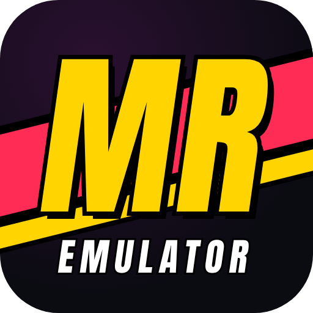
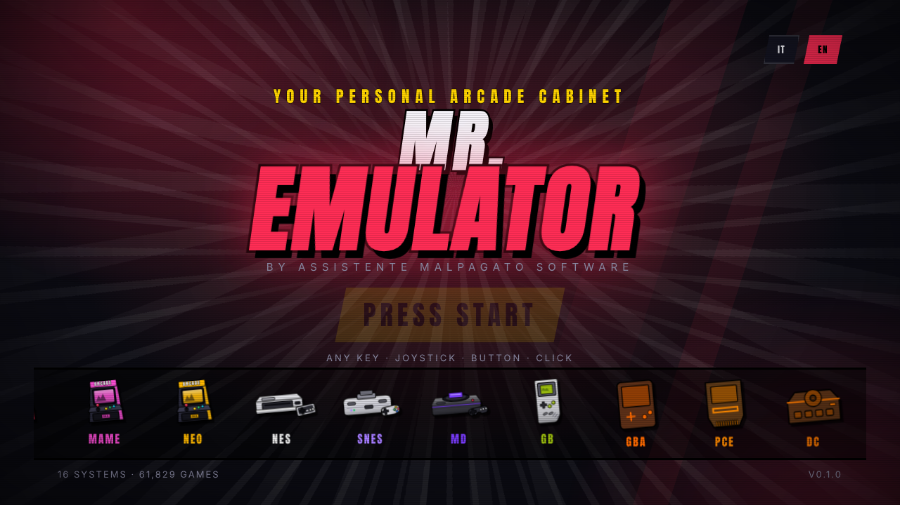

<div align="center">



# MR. EMULATOR

### *Il tuo cabinato arcade personale. Scegli il sistema. Scegli il gioco. FIGHT!*

<sub>**by Assistente Malpagato software**</sub>

[](https://github.com/VjAlbert/Mr.Emulator/releases/latest)

[English](README.md) · **Italiano**



</div>

---

## Cos'è

Un launcher grafico veloce e spettacolare per giochi arcade e console classiche, pensato per chi vuole **giocare, non configurare**. Si usa con **tastiera, mouse, gamepad o pannello arcade**; dietro le quinte guida emulatori open source consolidati ([RetroArch](https://www.retroarch.com/) e [MAME](https://www.mamedev.org/)).

## Scarica e installa

1. Premi il grande pulsante **Scarica per Windows** qui sopra (o apri la pagina [Releases](https://github.com/VjAlbert/Mr.Emulator/releases/latest)) e scarica `Mr-Emulator-Setup-<versione>.exe`.
2. Avvialo: l'installer mostra in italiano cosa ti serve (RetroArch, BIOS, ROM).
3. Apri Mr. Emulator: una **procedura guidata** ti accompagna passo per passo.

> Windows può mostrare *"Windows ha protetto il PC"* perché il programma non ha una firma digitale a pagamento: premi **Ulteriori informazioni → Esegui comunque**.

## Novità

- 🌍 **Italiano e inglese** nel programma (Impostazioni → Generale, oppure i pulsanti IT/EN della schermata iniziale).
- 🎬 **Nuova schermata iniziale "PREMI START"** con la fila di console.
- 🧭 **Procedura guidata** del primo avvio con **download dei core** e controllo dei BIOS.
- 🎛️ **Assegnazione manuale dei pulsanti** per tastiera, pad ed encoder, per due giocatori.
- 🖥️ **Modalità schermo** (altezza piena, pixel perfetti, pixel perfetti in altezza, stirata) con anteprima sulle misure reali, per sistema, monitor verticale e overlay.
- 🕹️ **Nuovi sistemi**: Dreamcast, Naomi, Atomiswave, PlayStation, Nintendo 64, Nintendo DS, Atari Jaguar, 3DO, PC Engine, Game Gear, MSX e altri.
- 🎨 **Temi**, scelta dello **shader CRT**, **modalità cabinato** (avvio con Windows, schermo intero, cursore nascosto).
- 🖼️ **Copertine sempre presenti** (altre regioni, oppure una copertina generata) e schermata **Diagnostica**.

## Primi passi

1. **Giochi**: la guida crea una cartella per sistema in `Documenti\MrEmulator` o sul disco che scegli. Copiaci le tue ROM.
2. **RetroArch**: scaricalo da [retroarch.com](https://www.retroarch.com/) (Windows 64 bit, si estrae e basta) e indica `retroarch.exe`. I **core** li scarica il programma.
3. **BIOS**: servono solo a pochi sistemi (Neo Geo `neogeo.zip`, PlayStation `scph5501.bin`, Dreamcast `dc_boot.bin` + `dc_flash.bin`, Naomi/Atomiswave `naomi.zip` + `awbios.zip`, FDS `disksys.rom`, 3DO `panafz10.bin`). La guida mostra cosa manca e dove metterlo.
4. **MAME** (facoltativo) per il sistema Arcade (MAME) e per i nomi dei giochi.

Se qualcosa non va: **Impostazioni → Diagnostica**.

## Costruire dal codice

```bash
git clone https://github.com/VjAlbert/Mr.Emulator.git
cd Mr.Emulator
npm install
npm run dev     # avvia in sviluppo
npm test        # test automatici
npm run dist    # installer per Windows (su Windows) → release\
```

## ⚖️ ROM e BIOS

**Mr. Emulator non include, non scarica e non distribuisce ROM né BIOS.** Funziona con i file che possiedi e che hai ottenuto legalmente. Questo repository non conterrà mai materiale protetto da copyright.

Licenza: [MIT](LICENSE) · Roadmap: [`docs/ROADMAP.md`](docs/ROADMAP.md)
