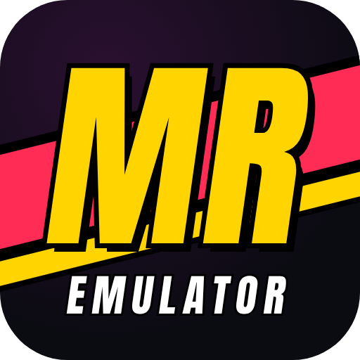
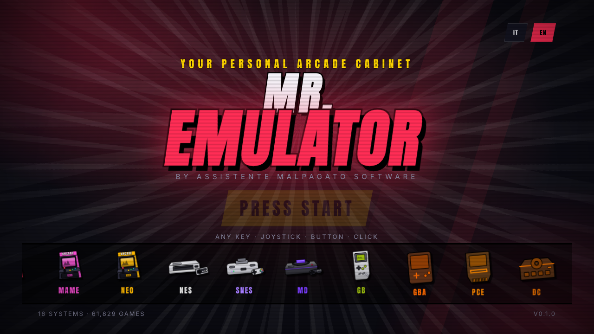
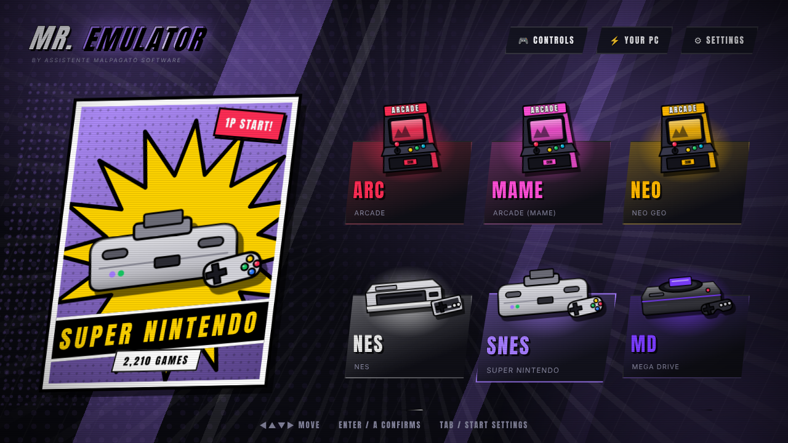
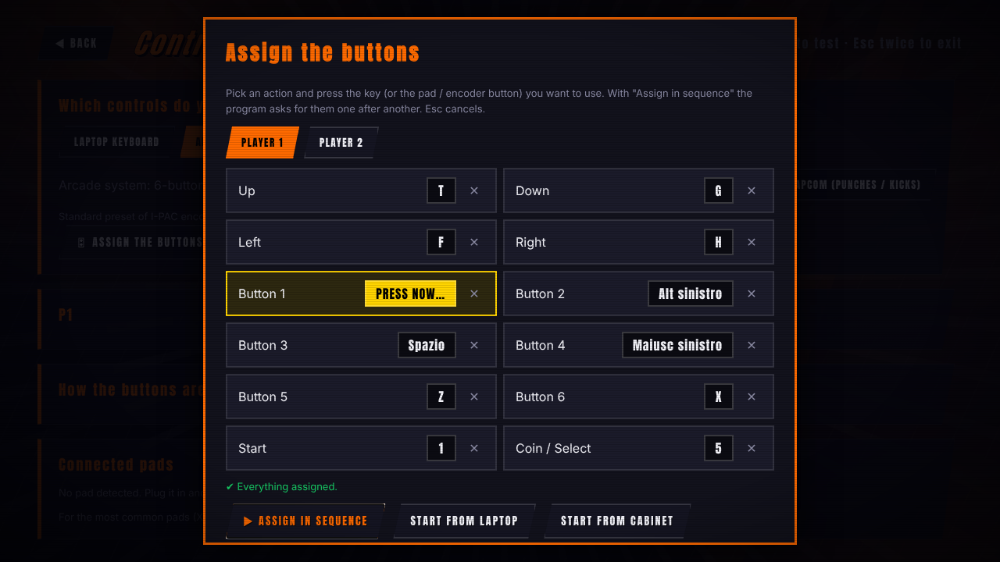

<div align="center">



# MR. EMULATOR

### *Your personal arcade cabinet. Pick a system. Pick a game. FIGHT!*

<sub>**by Assistente Malpagato software**</sub>

[](https://github.com/VjAlbert/Mr.Emulator/releases/latest)

[](https://github.com/VjAlbert/Mr.Emulator/releases/latest)
[](https://github.com/VjAlbert/Mr.Emulator/releases)


**English** · [Italiano](README.it.md)



</div>

---

## What is Mr. Emulator?

A fast, flashy launcher for arcade and classic console games, built for people who want to **play, not configure**. It is navigated entirely with a **keyboard, mouse, gamepad or arcade panel**, and behind the scenes it drives proven open-source emulators ([RetroArch](https://www.retroarch.com/) cores and [MAME](https://www.mamedev.org/)). In front of you there is only one decision: *what are we playing tonight?*

<div align="center">
 
</div>

## Download

> 1. Click the big **Download for Windows** button above (or open the [Releases](https://github.com/VjAlbert/Mr.Emulator/releases/latest) page) and download `Mr-Emulator-Setup-<version>.exe`.
> 2. Run it. The installer shows, in plain words, what you will need (RetroArch, BIOS files, your ROMs).
> 3. Start Mr. Emulator: a **first-run guide** walks you through the rest.
>
> Windows may show *"Windows protected your PC"* because the app is not signed with a paid certificate. Click **More info → Run anyway**.

## Features

### Look and feel
- 🎨 **Two visual styles for the whole program**: **Comic** (poster with a yellow burst, halftone dots, panel-page background, hard-shadow buttons) and **Stage** (spotlight and glowing ring). Switch any time in *Settings → Look*.
- 🏠 **System select screen**: every system shows its console as a poster, with pop-out tiles around it. Illustrations are included; you can add **your own photos** (`snes.png`, `psx.png`…) and the program turns them into comic art (background removed, bold outline), or shows them as they are.
- 🌈 **Themes** (Fighter, Neon, Green phosphor, Night), sound effects, "PRESS START" title screen, INSERT COIN sequence and an **attract mode** that rotates covers when idle.
- 🌍 **English and Italian**, switchable any time.

### Library
- 📚 Scans huge collections in the background (tested on 54,000 files) with instant search, jump by letter or decade, families (Capcom, Sega, Taito…), **favorites**, **recent games** and a **most played** list.
- 🖼️ **Covers and screenshots, free and automatic**: picked from the official libretro lists even when your file names differ (regions, discs, "Zelda, The"…). One button per system downloads them all (*Settings → Covers*); a comic-style cover is generated when none exists. Local image packs (snap, flyers, titles) take priority.
- 💿 **Multi-disc games** (PlayStation, 3DO, Dreamcast): one entry per game with an automatic `.m3u`.
- 🎬 **Multimedia pack**: video snaps in a frame on the selected game and a soundtrack player.
- 🏷️ Real game names from DAT files (FinalBurn Neo, MAME) and MAME Software Lists.
- ⏱ **Play statistics**: time played and number of sessions.
- 🧪 **ROM check** with MAME's verifier: lists broken ZIPs and which files to replace.

### Playing
- 💾 **Saves, done properly**: one saves folder next to your ROMs; console progress is saved on exit and every 10 s. Before a game with a save you choose **Continue** or **New game** (the old save is kept as a safety copy). **Resume can be set for each console**. Arcade has a per-game **Resume** switch, MAME **high scores** are kept, and *Settings → Saves* backs up and restores everything as a ZIP.
- 🏆 **Trophies (RetroAchievements)**: log in with your free account and games launched with RetroArch award trophies (optional hardcore mode).
- 🪄 **Cheats**: one click downloads RetroArch's cheat database; when there is a file for the game you start, it is loaded automatically.
- 🕹️ **Controls**: keyboard, gamepad and arcade-panel presets, **manual button mapping** for two players (covers non-Xbox pads such as PS3 clones: L1/R1/L2/R2/L3/R3, hat D-pads, analog triggers), conflict detection, and a live "Controls" test screen.
- 🚪 **Exit and game menu without a keyboard**: Select + Start on a gamepad, Coin + Start on an arcade panel (configurable).
- 🖥️ **Screen**: four image modes (full height, pixel perfect, pixel perfect in height, stretched) with a live preview on your real screen, per-system overrides, vertical-monitor mode for MAME, **borders (overlays)** picked automatically per system, and **CRT shaders**.
- ✨ **Pixel sharpness** (Soft or High quality xBRZ, combinable with CRT): offered only when the PC can handle it.
- ⚡ **Auto-tuning**: detects your PC and screens, picks a Light / Balanced / Max profile per system, uses the powerful GPU on dual-GPU laptops, and adapts after the question "how did it go?".
- 🏠 **Cabinet mode**: start with Windows, borderless full screen, hidden cursor, protected exit.

### Setup and care
- 🧭 **First-run guide**: folders, RetroArch, **one-click core download**, BIOS checklist (with known-file verification) and MAME. It can be run again at the end of *Settings*.
- 🔎 **Finds RetroArch and MAME** if they are already on your PC, and links to their official sites if not (the program never downloads or runs other programs by itself). It reminds you that **MAME must match your ROM set's version**.
- 🩺 **Diagnostics** screen that checks folders, cores, BIOS files and RetroArch's log, plus a copyable report; error messages follow the program's language.
- 🔔 **Update notice** when a new release is out (one request a day, can be turned off).
- 🛡️ Safer saving (settings survive power cuts), error log, single instance.

## Supported systems

| Family | Systems |
|---|---|
| **Arcade** | Arcade (FBNeo), Arcade (standalone MAME), Neo Geo, Sega Naomi, Atomiswave |
| **Sega** | Master System, Mega Drive, Game Gear, SG-1000, Dreamcast |
| **Nintendo** | NES, Famicom Disk System, SNES, Game Boy / Color / Advance, Nintendo 64, Nintendo DS |
| **NEC / SNK** | PC Engine / TurboGrafx-16, SuperGrafx, Neo Geo Pocket |
| **Sony / Atari / 3DO** | PlayStation, Atari Jaguar, 3DO |
| **Computers & others** | MSX, ZX Spectrum, ColecoVision, Fairchild Channel F, Bally Astrocade |

The list can change as the project grows. Systems you do not use can be hidden in *Settings → Systems on home*.

## Quick start

1. **Games** – the first-run guide creates one folder per system (`nes`, `snes`, `megadrive`, `psx`…) in `Documents\MrEmulator` or on any drive you choose. Copy your ROMs there.
2. **RetroArch** – the guide looks for it on your PC; if it is not there, get it from [retroarch.com](https://www.retroarch.com/) (Windows 64-bit, just extract it) and point the guide to `retroarch.exe`. Mr. Emulator downloads the **cores** for you from the official archive.
3. **BIOS** – only a few systems need one. The guide shows a checklist:

| System | File | Folder |
|---|---|---|
| Neo Geo | `neogeo.zip` | `bios\fbneo` |
| PlayStation | `scph5501.bin` (or `5500` / `5502`) | `bios` |
| Dreamcast | `dc_boot.bin`, `dc_flash.bin` | `bios\dc` |
| Naomi / Atomiswave | `naomi.zip`, `awbios.zip` | `bios\dc` |
| Famicom Disk System | `disksys.rom` | `bios` |
| 3DO | `panafz10.bin` | `bios` |

4. **MAME** *(optional)* – for the Arcade (MAME) system and for proper game names, from [mamedev.org](https://www.mamedev.org/release.html). **Use the MAME version that matches your ROM set** (a 0.229 set needs MAME 0.229): ROM sets only work with their own version.

Something not working? Open **Settings → Diagnostics**: it tells you what is missing and how to fix it.

## Controls

- **Keyboard**: arrows + Enter / Esc / Tab, `F2` favorite, `F3` soundtrack, `/` search.
- **Gamepad / arcade panel**: D-pad or stick to move, button 1 confirm, button 2 back. Presets for a laptop keyboard (WASD + J K L), I-PAC-style encoders, or your own mapping.
- **Exiting a game and opening the game menu without a keyboard:**

| | Exit the game | Game menu |
|---|---|---|
| **Keyboard** | `Esc` | `F1` (RetroArch) · `Tab` (MAME) |
| **Arcade panel (I-PAC)** | hold **Coin 1** + press **Start 1** | hold **Coin 1** + press **Button 1** |
| **Gamepad (Xbox, PlayStation, 8BitDo…)** | **Select + Start** | hold **Start** for 2 s (RetroArch) · **Select + A** (MAME) |

  The gamepad combinations can be changed (or disabled) in *Controls → Exit the game and open the menu*. In MAME the menu gives access to DIP switches, input mapping, service mode and reset.

## Screen and cabinet tips

- Most arcade and console games are 4:3: on a widescreen they have side bars unless you stretch them (which distorts) or use an artwork overlay.
- *Pixel perfect* works best on screens whose height is a multiple of 224/240 lines: **1920×1200 (×5)**, **2560×1440 (×6)**, **4K (×9)**.
- For a cabinet, a **27" 2560×1440 IPS** panel behind a bezel with a 4:3 opening is a very safe choice.

## Build from source

```bash
git clone https://github.com/VjAlbert/Mr.Emulator.git
cd Mr.Emulator
npm install
npm run dev        # run the app in development
npm test           # automated tests
npm run dist       # Windows installer (run on Windows) → release\
```

The installer is also built on GitHub (free Windows runner): **Actions → Installer for Windows → Run workflow**. Tick **"Publish a GitHub Release"** to publish it in *Releases* (this is what powers the download button), or push a tag such as `v0.2.12`.

Roadmap: [`docs/ROADMAP.md`](docs/ROADMAP.md).

## ⚖️ ROMs and BIOS

**Mr. Emulator does not include, download or distribute ROMs or BIOS files.** It works with files you own and obtained legally, for example backups of your own games and consoles. This repository will never contain copyrighted material.

## Built with

Electron · TypeScript · React · [RetroArch / Libretro](https://www.libretro.com/) · [MAME](https://www.mamedev.org/) · [FinalBurn Neo](https://github.com/finalburnneo/FBNeo) · covers from [libretro-thumbnails](https://github.com/libretro-thumbnails). Thanks to every emulator developer who made this possible.

## License

[MIT](LICENSE)

<div align="center">

**INSERT COIN TO CONTINUE** 🪙

</div>
