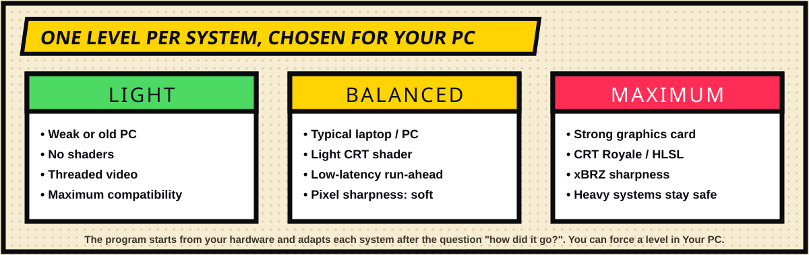

[◀ Home](Home) · **Auto-tuning**

# ⚡ Auto-tuning

Mr. Emulator is meant to run on everything from an old laptop with 6–8 GB of RAM and a small graphics card to a strong desktop. So it never uses one fixed configuration: it **detects your hardware and picks the settings per system**.

## What it detects

- **CPU** and its class, **RAM**, **graphics card(s)** and class, and whether it is a **hybrid-GPU laptop** (then it asks Windows to use the powerful card for the game).
- **Screens**: size, refresh rate, which one is primary. Refresh rates that are exact multiples of 60 Hz use a fixed swap interval; otherwise it stays automatic.
- **Where the launcher is** — so on a multi-monitor setup the game opens on the right screen.

## Levels

| Level | Typical machine | What changes |
|---|---|---|
| **Light** | Weak or old PC | No shaders, threaded video, bigger audio buffer — maximum compatibility. |
| **Balanced** | Typical laptop / PC | Light CRT shader where it makes sense, low-latency **run-ahead** on light systems, soft sharpness available. |
| **Maximum** | Strong graphics card | CRT Royale / HLSL, xBRZ sharpness; heavy systems stay safe. |

The level is **per system**: a 3D console on the same PC can run lighter than a NES.

## It learns

After a real game (at least 45 seconds) the program may ask **"how did it go?"**. Your answer nudges that system's level up or down (from −2 to +1), so a system that stutters gets lighter next time and one that runs perfectly can be raised. You can turn this off, or force a level in **Your PC**.

## Safety rules

- Effects that need power (CRT Royale, xBRZ) are **offered only when the PC can take it** and are skipped for heavy systems.
- Screens under 900 px tall get no scanline effects (they look bad); 4K with a modest card gets only the lightest shader.
- Run-ahead is used only for light systems and a non-weak CPU.
- If MAME crashes on a game, it retries with simpler video settings (without shader, OpenGL, GDI, no custom controls/audio) and **remembers what worked for that game**.

## See what it decided

**Your PC** shows the detected hardware, the level for each system and a one-line summary such as *"Balanced · CRT Easymode · less input lag · full height"*. **Diagnostics** shows the exact settings requested at the last game.

[◀ Covers & image cache](Covers-and-Cache) · [Next: Comparison ▶](Comparison)
