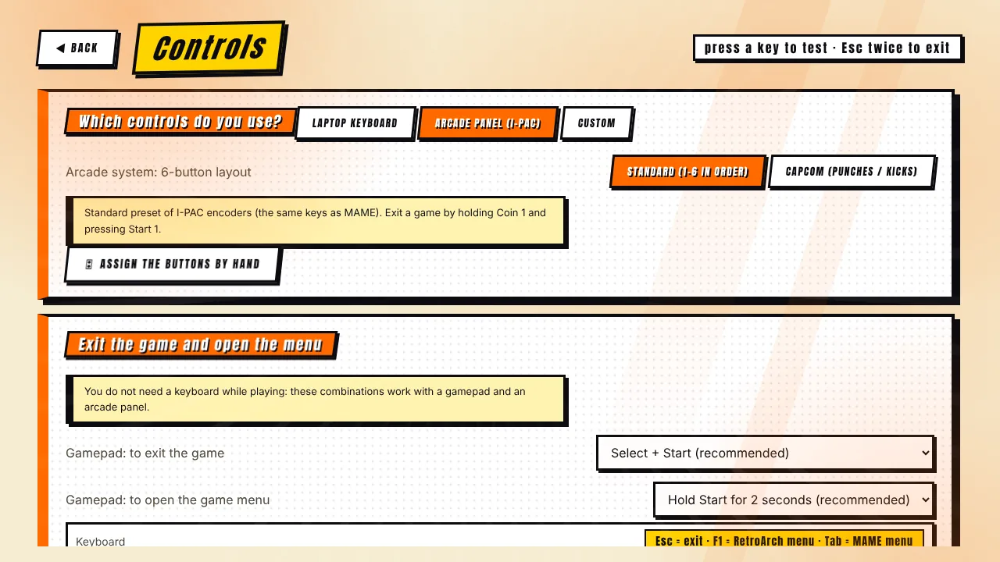
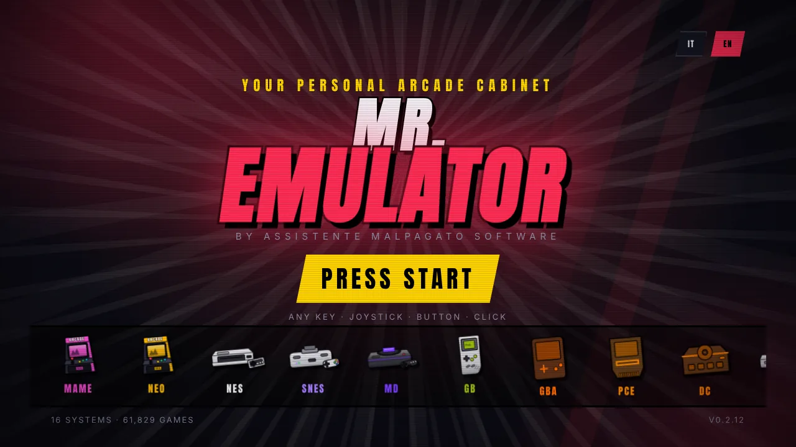

[◀ Home](Home) · **Cabinet guide**

# 🕹️ Cabinet guide

 

Mr. Emulator started life with arcade cabinets in mind. This page puts together everything that matters when the PC lives inside a cabinet. Hardware remarks are general advice, **not guarantees**: test with your own parts.

## Software setup

1. Install Mr. Emulator and run the [first-run guide](Getting-Started).
2. **Settings → Cabinet mode**: turn on *Borderless full screen*, *Start with Windows*, *Hide the mouse cursor* and, if the cabinet is public, *Block accidental closing*. With the lock on, leave with **Ctrl + Shift + Q** or the button in the same tab.
3. **Controls**: pick **Arcade panel (I-PAC)** and the button layout (*Standard* 1–6, or *Capcom* punches/kicks). Use *Assign the buttons by hand* if your encoder is wired differently.
4. Keep the **default exit combo** (hold Coin 1 + press Start 1) so that anyone can leave a game without a keyboard. The game menu is Coin 1 + Button 1.
5. **Settings → General**: tick *Interface sounds*, keep *INSERT COIN sequence* and *Cover rotation when idle* if you like the attract-mode feel.

## Screen

- Most arcade games are **4:3**. On a widescreen panel either accept side bars, fill them with a **graphic border** (Settings → Screen), or stretch (distorts).
- A **27" 2560×1440 IPS** panel behind a bezel with a 4:3 opening is a very safe choice [Probabile]. Heights that are multiples of the game's lines look best with *Pixel perfect*: **1920×1200 (×5)**, **2560×1440 (×6)**, **4K (×9)**.
- **Vertical monitor** (tate): mount it rotated, rotate the screen in Windows, then choose clockwise / counter-clockwise in *Settings → Screen*. Vertical shoot'em-ups then use the whole screen (MAME).
- For an authentic look try a **CRT effect** (*Easymode* is light) and/or **pixel sharpness**, if your hardware allows it. See [Screen & image quality](Screen-and-Image).

## Arcade engines

- **Arcade (FBNeo)** is fast and light and good for the classics; **Arcade (MAME)** covers far more machines, needs `mame.exe` and a ROM set that matches that exact MAME version.
- Use **ROM check** (Settings → General) after copying a set: it lists broken ZIPs and which files to replace.
- MAME keeps **high scores** for supported games and has a per-game **Resume** switch in the preview.
- CHD disk images go in the CHD folder (or inside the ROM folder).

## Controls tips

- Panels that present themselves as keyboards (I-PAC and similar) work with the keyboard presets; encoders that present as gamepads work with manual mapping.
- Gamepads: PS3 clones with extra buttons, hats and analog triggers are handled; Xbox pads use the real Start/Back for Start/Coin in MAME.
- The **Controls** screen shows live what each button does — use it to check wiring.

## Keeping it running

- Start with Windows + borderless full screen gives a console-like boot.
- Settings are saved atomically, so a power cut does not corrupt them, and console saves are written every 10 seconds.
- A **backup** of the saves folder (Settings → Saves → *Back up to a ZIP*) is the one thing worth doing before a long event.
- If something misbehaves, **Diagnostics** names the problem and gives a text report.

[◀ Settings reference](Settings-Reference) · [Next: FAQ ▶](FAQ)
