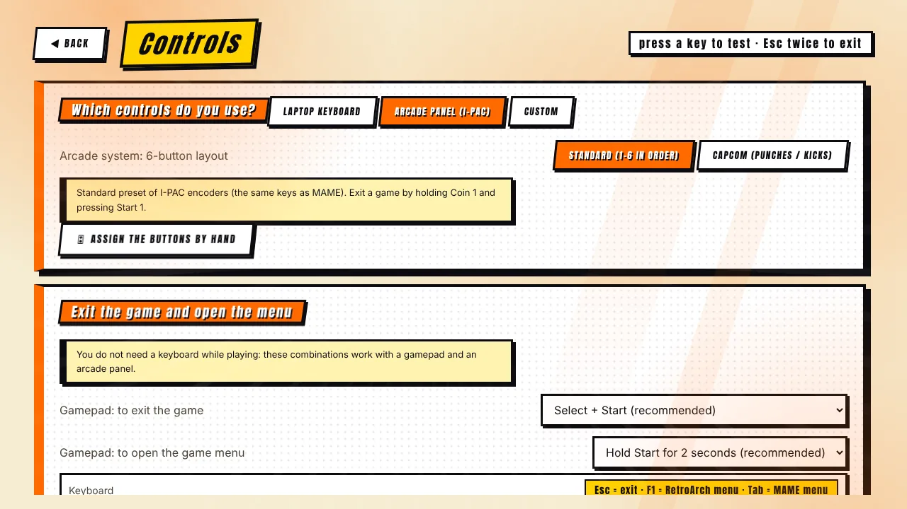

[◀ Home](Home) · **Controls**

# 🕹️ Controls

Mr. Emulator is navigated entirely with **keyboard, mouse, gamepad or arcade panel**, and it writes matching input settings for RetroArch **and** MAME, so what you configure once works everywhere.

## Presets

| Preset | For | Notes |
|---|---|---|
| **Laptop keyboard** | Playing on a keyboard | WASD + J / K / L and friends for player 1, arrow keys and numpad for player 2. |
| **Arcade panel (I-PAC)** | A cabinet with an I-PAC-style encoder | Two players, six buttons each, the same keys as MAME. |
| **Custom** | Anything else | Your own mapping (see below). |

For the arcade system there are two button layouts: **Standard** (1–6 in order) and **Capcom** (three punches, three kicks).

## Manual mapping

**Controls → Assign the buttons by hand** walks you through every action for two players: press the key, button or move the axis you want. It detects conflicts, and it works with keyboards, gamepads and encoders. The mapping is used by RetroArch, by MAME and by the launcher menu.

Gamepads that are not Xbox-style are covered too: PS3 clones with more than six buttons, **L1 / R1 / L2 / R2 / L3 / R3**, D-pads reported as a "hat", and analog triggers.

## Test your devices

The **Controls** screen shows in real time what each key, button or axis is doing, so you can check a new encoder or pad before launching a game.

## Launcher navigation

| Action | Keyboard | Gamepad / panel |
|---|---|---|
| Move | Arrows | D-pad or stick |
| Confirm | Enter | Button 1 |
| Back | Esc | Button 2 |
| Search | `/` | Y (pad) · button 4 (panel) |
| Favorite | F2 | — |
| Soundtrack | F3 | — |
| Settings | Tab | Start |

## Exit and game menu — no keyboard needed

| | Exit the game | Game menu |
|---|---|---|
| **Keyboard** | `Esc` | `F1` (RetroArch) · `Tab` (MAME) |
| **Arcade panel (I-PAC)** | hold **Coin 1** + press **Start 1** | hold **Coin 1** + press **Button 1** |
| **Gamepad (Xbox, PlayStation, 8BitDo…)** | **Select + Start** | hold **Start** for 2 s (RetroArch) · **Select + A** (MAME) |

The gamepad combinations can be changed — or disabled — in **Controls → Exit the game and open the menu**. In MAME the menu gives access to DIP switches, input mapping, service mode and reset. On Xbox pads, MAME's Start and Coin use the real Start/Back buttons.

## Tips for cabinets

- Turn on **Cabinet mode** (Settings) to start with Windows, borderless full screen, hidden cursor and a protected exit.
- Keep the *standard* exit combo on the panel, so a guest can always leave a game without a keyboard.

[◀ Systems & BIOS](Systems) · [Next: Screen & image quality ▶](Screen-and-Image)
