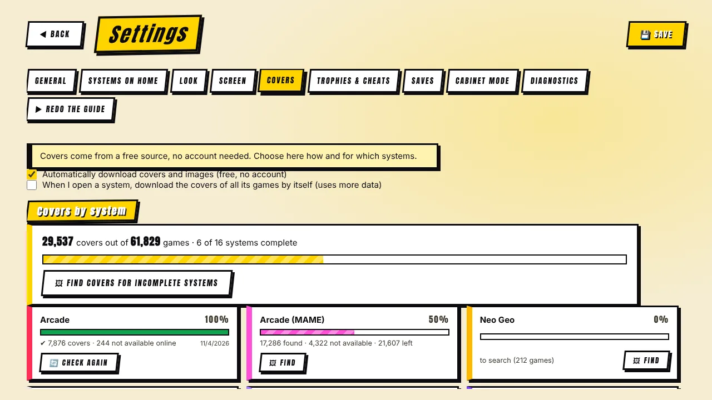

[◀ Home](Home.md) · **Covers & image cache**

# 🖼️ Covers & image cache

## Where covers come from

Covers and screenshots come from the free **libretro-thumbnails** archive — no account, no paid API. The program looks up the official list for each system and picks the right file **even when your file names differ** (regions, discs, "Zelda, The"…). If nothing exists, it generates a comic-style cover (title, system, year).

Order of preference for every image:

1. **Your Multimedia packs** (snaps, flyers, titles) if you set a folder — used **in place**, never copied.
2. The local cache.
3. A download (only if downloading is on in Settings).

## Settings → Covers

- **Summary** — "29,537 covers out of 61,829 games · 6 of 16 systems complete".
- **A card per system** with a progress bar: how many covers were found, how many are **not available online** (searched once, not retried on every launch), how many are left, and the date of the last complete search.
- **Find covers for incomplete systems** runs them one after the other; **Stop all** cancels.
- Optionally the program downloads all covers of a system when you open it (uses more data).

## The image cache

Images are stored in a cache. In **Settings → Covers → Space used by images** you can:

| Tool | What it does |
|---|---|
| **Where to keep the cache** | Choose a folder (for example on another drive). A `MrEmulator-artwork` folder is created inside. **Move the cache here** carries the images already downloaded — and your console photos — over, with a progress bar, and removes the old copy only after success. |
| **Optimize (compress)** | Recompresses images already in the cache (max 640 px, JPEG). Only rewrites a file if it gets smaller. |
| **Remove pack copies** | Deletes copies of Multimedia-pack images made by old versions. |
| **Empty all** | Deletes every downloaded image; indexes stay. |
| **Space limit** | Optional (1–20 GB): the oldest images are removed above the limit. Default: no limit. |

New downloads are already stored **resized and compressed**, typically a few tens of KB each instead of hundreds. Images from your Multimedia packs are no longer copied into the cache.

## Your own console photos

Every system shows its console. Put a PNG/JPG/WEBP named after the system (`snes.png`, `psx.png`…) in the console-photos folder (**Settings → Look**, you can pick any folder) and the program turns it into comic art — or shows it as is (untick *Turn photos into comic style*). Where there is no photo it uses an illustration, or a symbol.

Photos should be **yours or public domain**, ideally on a white or transparent background, ~800 px wide.

[◀ Saves, trophies & cheats](Saves-Trophies-Cheats.md) · [Next: Auto-tuning ▶](Auto-Tuning.md)
