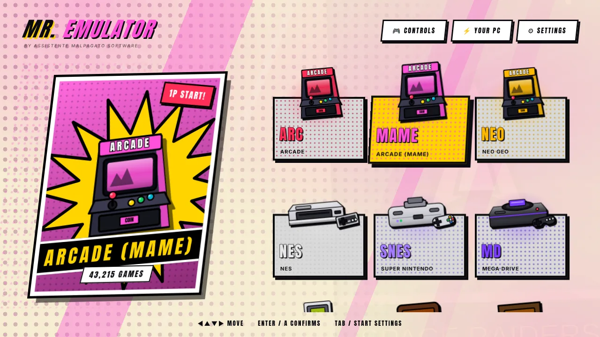
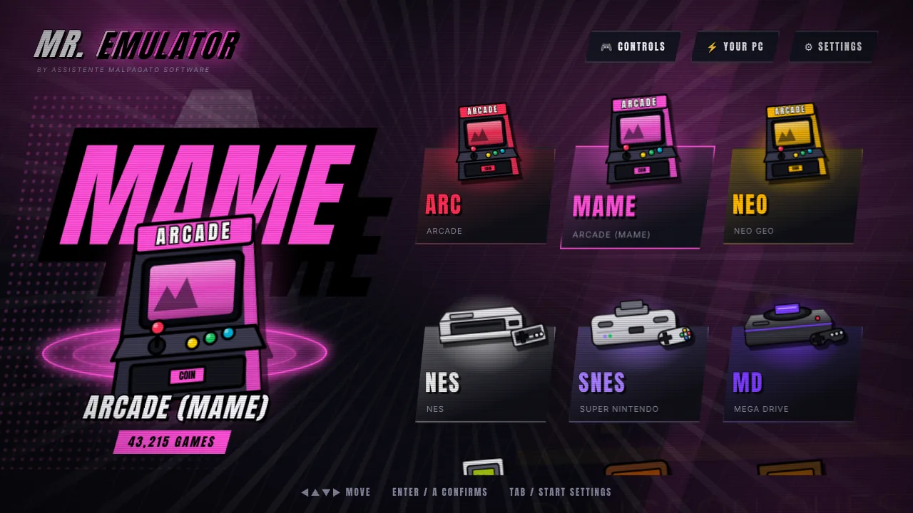
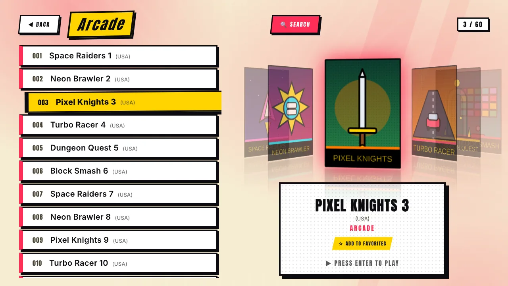
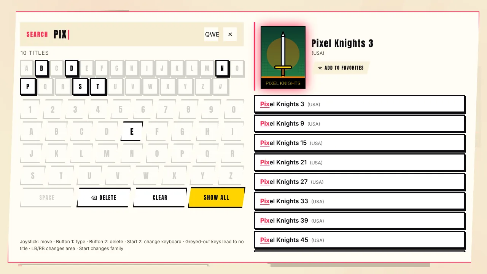
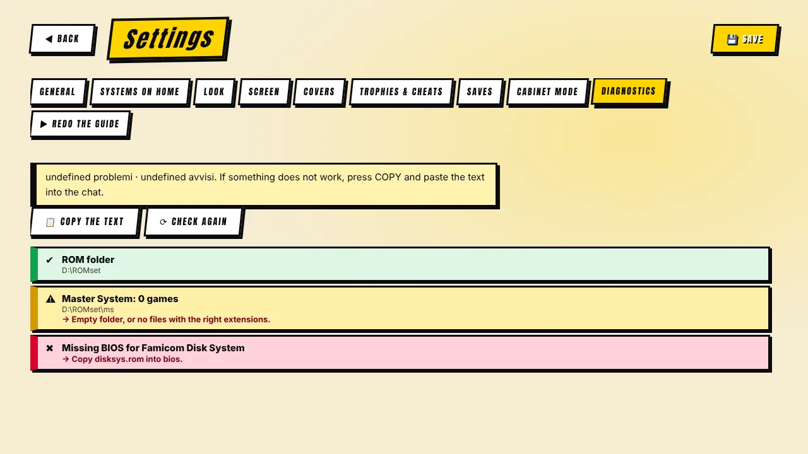
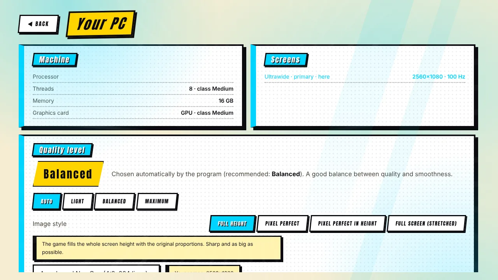

[◀ Home](Home) · **Features tour**

# ✨ Features tour

## Look and feel

 

- **Two complete styles.** *Comic* turns the whole program into a comic page (paper with halftone dots, white panels with black ink borders and hard shadows, yellow caption boxes, sticker buttons). *Stage* is a dark spotlight look with a glowing ring. Switch any time in **Settings → Look**.
- **Illustrated consoles.** Every system is shown as a poster with its console. Drop your **own photos** (`snes.png`, `psx.png`…) in a folder and the program turns them into comic art (background removed, bold outline) — or shows them untouched.
- **Four colour themes** (Fighter, Neon, Green phosphor, Night), synthesized sound effects, a "PRESS START" title screen, an INSERT COIN launch sequence and an **attract mode** that rotates covers when idle.
- **English and Italian**, switchable at any time.

## Library

 

- **Large collections.** Scans huge sets in the background (tested on 54,000 files) and keeps an index, so the list opens instantly.
- **Smart search.** Type with a joystick: the on-screen keyboard greys out letters that lead to no title, results appear as you type, with the cover of the first hit. Numbers and one/two-letter words match at the start of a word, so "2" does not find "1942".
- **Filters.** Families (Capcom, Sega, Taito…), decades, **favorites**, **recent games**, **most played**, *surprise me*.
- **Covers and screenshots, free.** From the official libretro lists, matched even when your file names differ (regions, discs, "Zelda, The"). See [Covers & image cache](Covers-and-Cache).
- **Multi-disc games** (PlayStation, 3DO, Dreamcast): one entry per game with an automatic `.m3u`.
- **Multimedia pack.** Video snaps in a frame on the selected game and a soundtrack player.
- **Real game names** from DAT files (FinalBurn Neo, MAME) and MAME Software Lists.
- **Play statistics** — time played and sessions.
- **ROM check** with MAME's verifier: lists broken ZIPs and which files to replace.

## Playing

- **Saves, trophies and cheats** → [Saves, trophies & cheats](Saves-Trophies-Cheats).
- **Controls** for keyboard, gamepads and arcade panels, manual mapping, exit/menu combos → [Controls](Controls).
- **Screen modes, borders, CRT shaders, pixel sharpness** → [Screen & image quality](Screen-and-Image).
- **Auto-tuning** → [Auto-tuning](Auto-Tuning).
- **Cabinet mode:** start with Windows, borderless full screen, hidden cursor, protected exit.

## Setup and care

 

- **First-run guide** and **core download** — [Getting started](Getting-Started).
- **Finds RetroArch and MAME** if they are already on your PC and links to their official sites if not. The program never downloads or runs other programs by itself.
- **Diagnostics** — folders, cores, BIOS, borders, sharpness, saves and the last RetroArch/MAME logs, with a copyable text report. Messages follow the program language.
- **Update notice** when a new release is out (one request a day, can be turned off).
- **Safer saving** — settings survive power cuts; error log; single instance.

[◀ Getting started](Getting-Started) · [Next: Systems & BIOS ▶](Systems)
