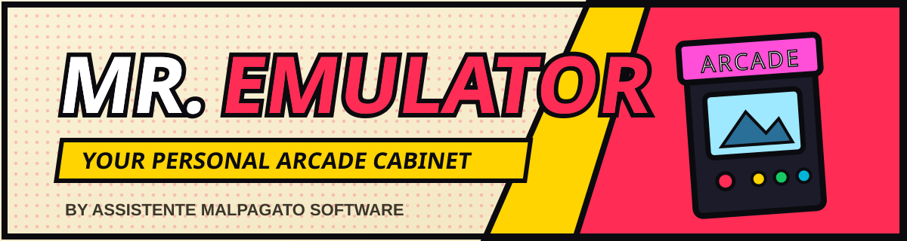
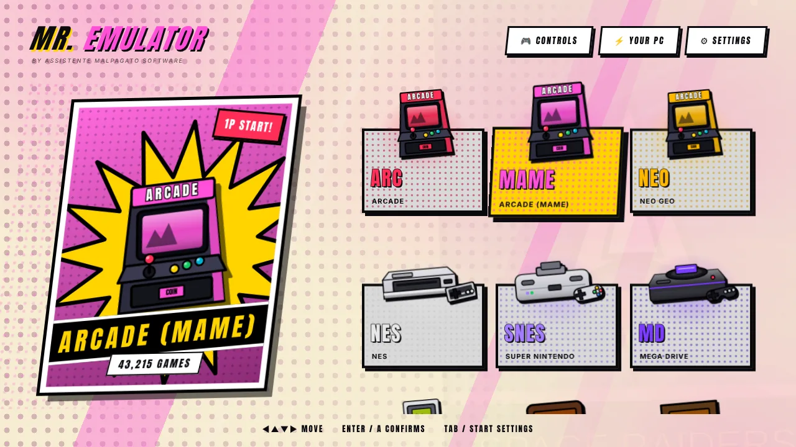
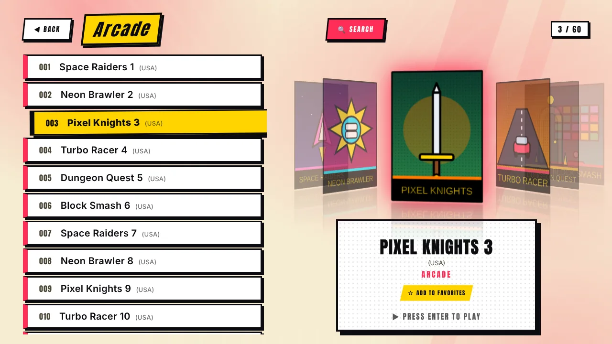
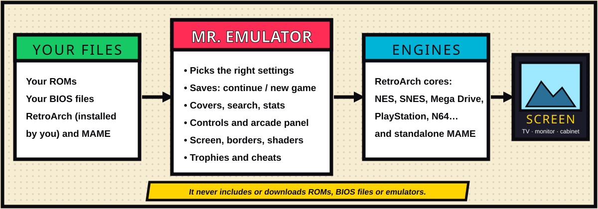

**English** · [Italiano](it/Home.md)

# Mr. Emulator Wiki

Mr. Emulator is a **free launcher for arcade and classic console games on Windows**, made for people who want to **play, not configure**. You pick a system, you pick a game, you play. Behind the scenes it drives proven open-source emulators — [RetroArch](https://www.retroarch.com/) cores and standalone [MAME](https://www.mamedev.org/) — and it tunes them for the PC you are sitting at.

 

> **It does not include, download or distribute ROMs, BIOS files or emulators.** You bring your own legally obtained files. See [Privacy & Legal](Privacy-and-Legal.md).

## Why another launcher?

| | |
|---|---|
| 🎯 **Zero configuration** | A first-run guide creates the folders, finds RetroArch and MAME, downloads the cores and checks the BIOS files. |
| ⚡ **Tuned for your PC** | It detects CPU, graphics card and screens and picks *Light / Balanced / Max* **per system**, then learns from your feedback. See [Auto-tuning](Auto-Tuning.md). |
| 💾 **Saves that just work** | Console progress is saved on exit and every 10 seconds. Before a game with a save you choose **Continue** or **New game**. No memory cards. |
| 🕹️ **Built for cabinets** | Arcade-panel (I-PAC) presets, exit and menu combos without a keyboard, manual button mapping for two players, cabinet mode. |
| 🎨 **A look of its own** | A full **comic-book** style or a **stage** style, with illustrated consoles and your own photos. |
| 🔎 **Instant search** | A smart on-screen keyboard that greys out letters leading nowhere — fast on 60,000 titles and usable with a joystick. |
| 🩺 **Diagnostics** | One screen tells you what is missing and how to fix it, and gives you a text report to share. |

## Where to start

| I want to… | Read |
|---|---|
| Install it and play my first game | [Getting started](Getting-Started.md) |
| See everything it can do | [Features tour](Features.md) |
| Know which systems are supported and what they need | [Systems & BIOS](Systems.md) |
| Set up a keyboard, gamepad or arcade panel | [Controls](Controls.md) |
| Fix black bars, pixel look, CRT effect | [Screen & image quality](Screen-and-Image.md) |
| Understand saves, trophies and cheats | [Saves, trophies & cheats](Saves-Trophies-Cheats.md) |
| Manage covers and where the image cache lives | [Covers & image cache](Covers-and-Cache.md) |
| Compare it with other launchers, honestly | [Comparison](Comparison.md) |
| Fix a problem | [Troubleshooting](Troubleshooting.md) |
| Contribute or understand the internals | [Under the hood](Under-the-Hood.md) |

---
Mr. Emulator is MIT-licensed and made by **Assistente Malpagato software**. Roadmap: [`docs/ROADMAP.md`](../ROADMAP.md) · Release notes: [`docs/RELEASE_NOTES.md`](../RELEASE_NOTES.md).
