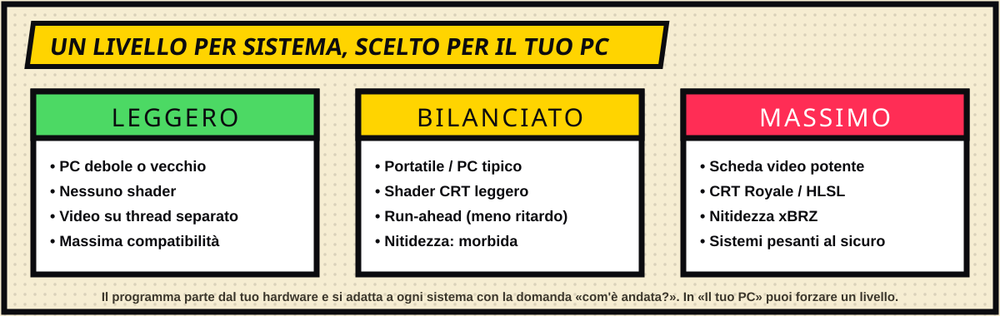

[◀ Home](IT-Home) · **Autoguida**

# ⚡ Autoguida

Mr. Emulator deve funzionare dal vecchio portatile con 6–8 GB di RAM e una piccola scheda video fino a un desktop potente. Per questo non usa mai una configurazione fissa: **riconosce l'hardware e sceglie le impostazioni per ogni sistema**.

## Cosa riconosce

- **CPU** e la sua classe, **RAM**, **scheda/e video** e classe, e se è un **portatile con due GPU** (allora chiede a Windows di usare la scheda potente per il gioco).
- **Schermi**: dimensioni, frequenza, quale è il principale. Le frequenze multiple esatte di 60 Hz usano un intervallo di scambio fisso; altrimenti resta automatico.
- **Dove sta il launcher** — così con più monitor il gioco si apre sullo schermo giusto.

## Livelli

| Livello | Macchina tipica | Cosa cambia |
|---|---|---|
| **Leggero** | PC debole o vecchio | Niente shader, video su thread separato, buffer audio più grande — massima compatibilità. |
| **Bilanciato** | Portatile / PC tipico | Shader CRT leggero dove ha senso, **run-ahead** (meno ritardo) sui sistemi leggeri, nitidezza morbida disponibile. |
| **Massimo** | Scheda video potente | CRT Royale / HLSL, nitidezza xBRZ; i sistemi pesanti restano al sicuro. |

Il livello è **per sistema**: una console 3D sullo stesso PC può girare più leggera di un NES.

## Impara

Dopo una partita vera (almeno 45 secondi) il programma può chiedere **«com'è andata?»**. La risposta sposta il livello di quel sistema in su o in giù (da −2 a +1): un sistema che scatta diventa più leggero la volta dopo, uno che va benissimo può salire. Puoi spegnere la funzione o forzare un livello in **Il tuo PC**.

## Regole di sicurezza

- Gli effetti che richiedono potenza (CRT Royale, xBRZ) sono **offerti solo se il PC li regge** e vengono saltati per i sistemi pesanti.
- Gli schermi sotto i 900 px di altezza non hanno effetti a righe (si vedono male); il 4K con una scheda modesta riceve solo lo shader più leggero.
- Il run-ahead si usa solo sui sistemi leggeri e con una CPU non debole.
- Se MAME va in crash su un gioco, riprova con impostazioni video più semplici (senza shader, OpenGL, GDI, senza comandi personalizzati/audio) e **ricorda cosa ha funzionato per quel gioco**.

## Vedere cosa ha deciso

**Il tuo PC** mostra l'hardware riconosciuto, il livello di ogni sistema e un riepilogo in una riga come *«Bilanciato · CRT Easymode · meno ritardo comandi · altezza piena»*. **Diagnostica** mostra le impostazioni esatte richieste all'ultimo gioco.

[◀ Copertine e cache](IT-Copertine-e-Cache) · [Avanti: Confronto ▶](IT-Confronto)
