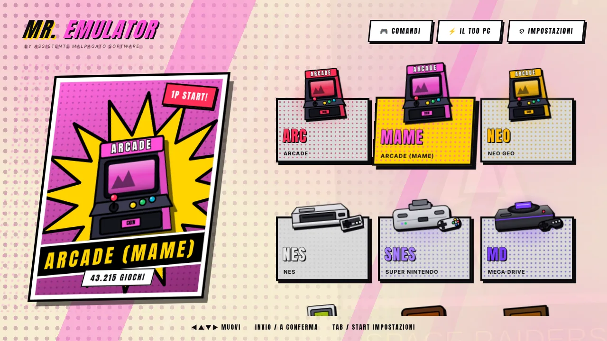
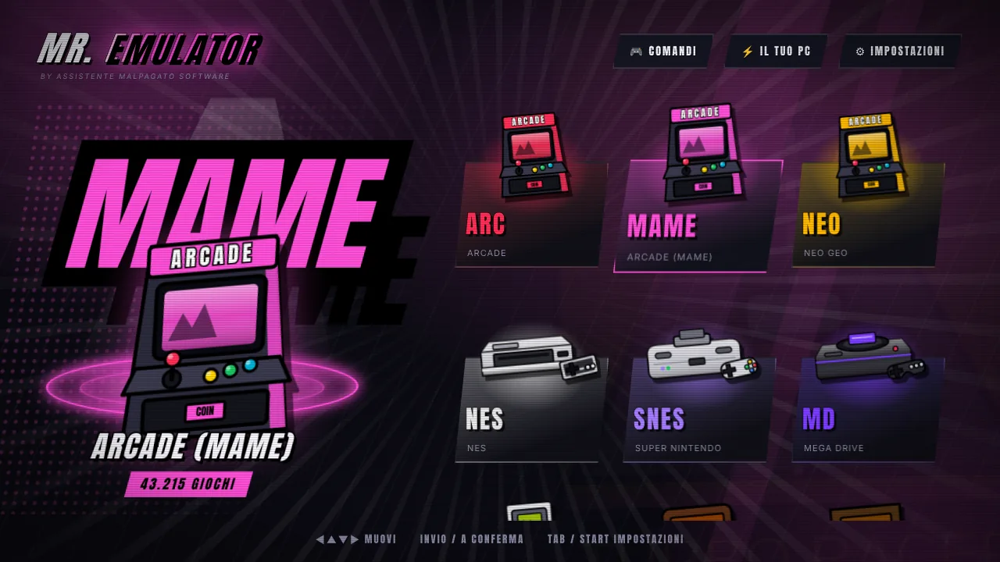
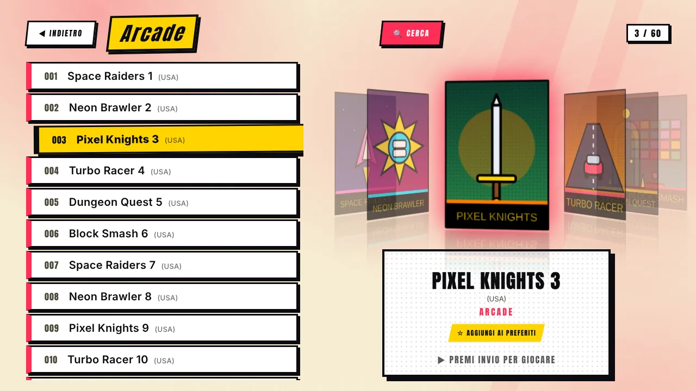
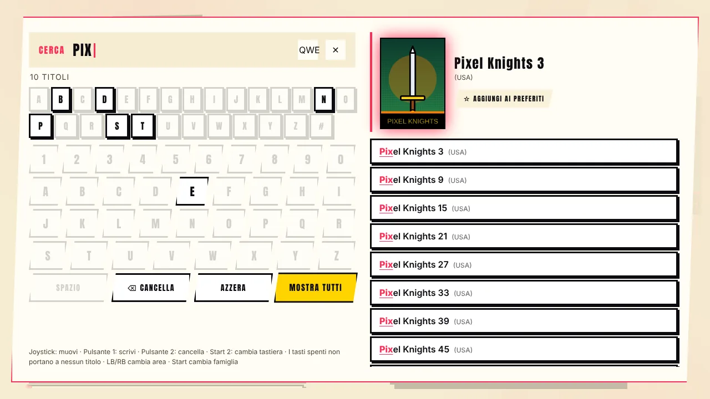
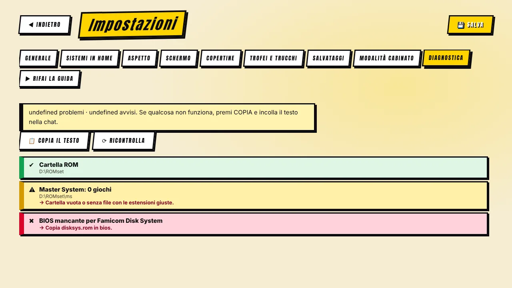
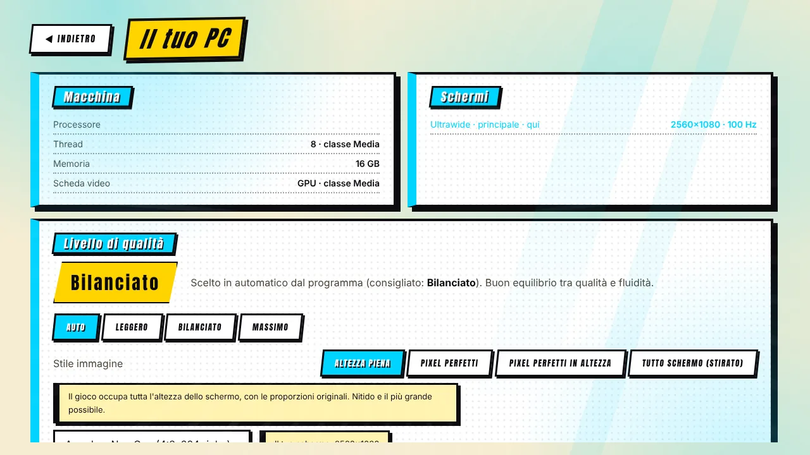

[◀ Home](IT-Home) · **Tour delle funzioni**

# ✨ Tour delle funzioni

## Aspetto

 

- **Due stili completi.** *Fumetto* trasforma tutto il programma in una pagina di fumetto (carta con retino, pannelli bianchi con bordo di china e ombra netta, didascalie gialle, pulsanti-adesivo). *Palcoscenico* è un look scuro con riflettore e anello luminoso. Si cambia quando vuoi in **Impostazioni → Aspetto**.
- **Console illustrate.** Ogni sistema è un poster con la sua console. Metti le **tue foto** (`snes.png`, `psx.png`…) in una cartella e il programma le trasforma in stile fumetto (sfondo tolto, contorno nero) — oppure le mostra così come sono.
- **Quattro temi di colore** (Picchiaduro, Neon, Fosforo verde, Notte), effetti sonori sintetizzati, schermata «PREMI START», sequenza INSERT COIN all'avvio e **attract mode** che fa ruotare le copertine a riposo.
- **Italiano e inglese**, cambiabili in qualsiasi momento.

## Libreria

 

- **Raccolte enormi.** Scansione in background di set giganteschi (provata su 54.000 file) con indice salvato: l'elenco si apre all'istante.
- **Ricerca intelligente.** Si scrive col joystick: la tastiera sullo schermo spegne le lettere che non portano a nessun titolo, i risultati compaiono mentre scrivi, con la copertina del primo. Numeri e parole di 1-2 lettere devono cominciare una parola, quindi «2» non trova «1942».
- **Filtri.** Famiglie (Capcom, Sega, Taito…), anni, **preferiti**, **ultimi giochi**, **più giocati**, *a sorpresa*.
- **Copertine e immagini gratuite.** Dalle liste ufficiali di libretro, abbinate anche se i nomi dei tuoi file sono diversi (regioni, dischi, «Zelda, The»). Vedi [Copertine e cache](IT-Copertine-e-Cache).
- **Giochi a più dischi** (PlayStation, 3DO, Dreamcast): una sola voce con `.m3u` automatico.
- **Pacchetto Multimedia.** Filmati in cornice sul gioco selezionato e lettore della colonna sonora.
- **Nomi veri dei giochi** da DAT (FinalBurn Neo, MAME) e dalle Software List di MAME.
- **Statistiche di gioco** — tempo giocato e partite.
- **Controllo ROM** con il verificatore di MAME: elenca gli ZIP difettosi e i file da sostituire.

## Giocare

- **Salvataggi, trofei e trucchi** → [Salvataggi, trofei e trucchi](IT-Salvataggi-Trofei-Trucchi).
- **Comandi** per tastiera, gamepad e pannelli arcade, assegnazione manuale, combinazioni di uscita/menu → [Comandi](IT-Comandi).
- **Modalità schermo, bordi, shader CRT, nitidezza dei pixel** → [Schermo e immagine](IT-Schermo-e-Immagine).
- **Autoguida** → [Autoguida](IT-Autoguida).
- **Modalità cabinato:** avvio con Windows, schermo intero senza bordi, cursore nascosto, uscita protetta.

## Installazione e cura

 

- **Guida al primo avvio** e **download dei core** — [Primi passi](IT-Primi-Passi).
- **Trova RetroArch e MAME** se sono già sul PC e rimanda ai siti ufficiali se mancano. Il programma non scarica né avvia altri programmi da solo.
- **Diagnostica** — cartelle, core, BIOS, bordi, nitidezza, salvataggi e ultimi registri di RetroArch/MAME, con testo copiabile. I messaggi seguono la lingua del programma.
- **Avviso di nuova versione** (una richiesta al giorno, si può spegnere).
- **Salvataggio sicuro** — le impostazioni sopravvivono a un'interruzione di corrente; registro degli errori; istanza unica.

[◀ Primi passi](IT-Primi-Passi) · [Avanti: Sistemi e BIOS ▶](IT-Sistemi-e-BIOS)
