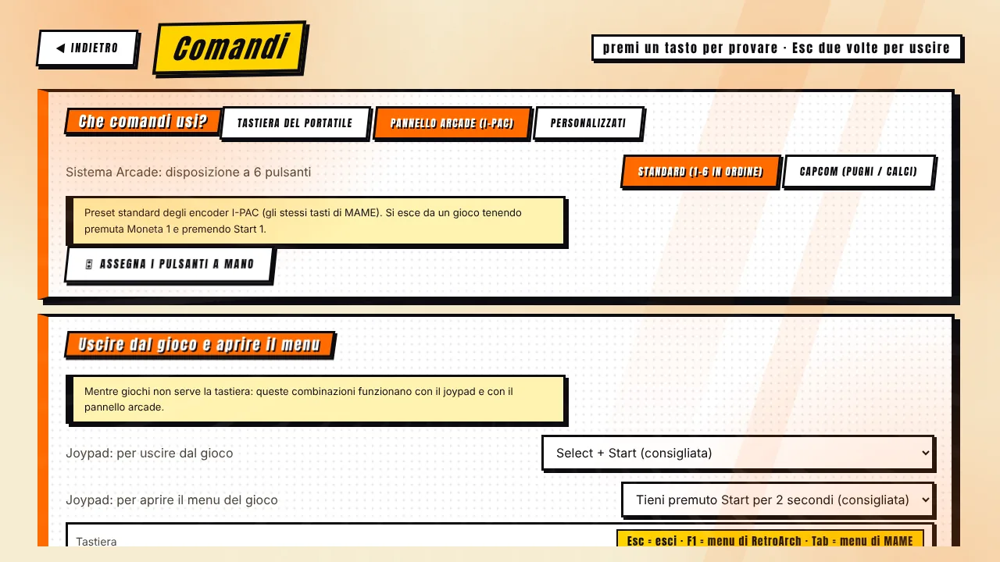
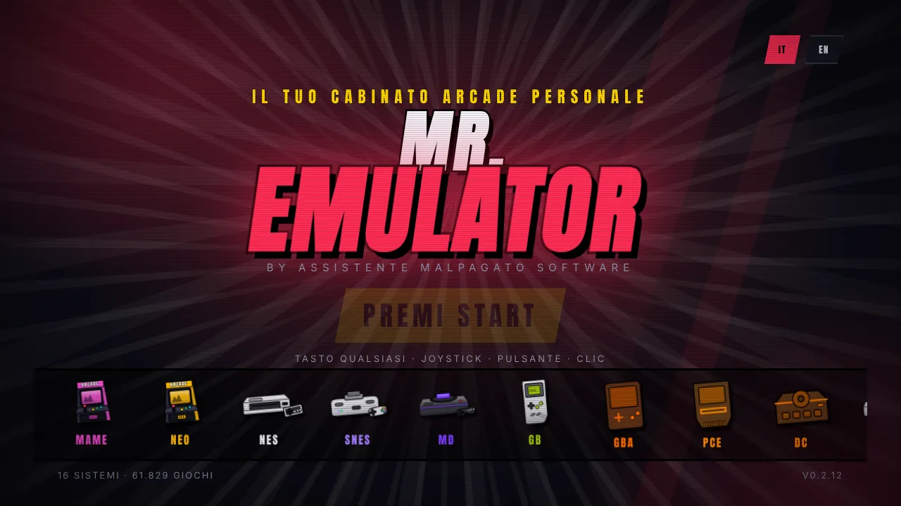

[◀ Home](IT-Home) · **Guida al cabinato**

# 🕹️ Guida al cabinato

 

Mr. Emulator è nato pensando ai cabinati arcade. Questa pagina raccoglie tutto ciò che conta quando il PC vive dentro un cabinato. Le osservazioni sull'hardware sono consigli generali, **non garanzie**: prova con i tuoi componenti.

## Configurazione del software

1. Installa Mr. Emulator e fai la [guida al primo avvio](IT-Primi-Passi).
2. **Impostazioni → Modalità cabinato**: attiva *Schermo intero senza bordi*, *Avvia con Windows*, *Nascondi il cursore del mouse* e, se il cabinato è pubblico, *Blocca la chiusura accidentale*. Con il blocco attivo si esce con **Ctrl + Maiusc + Q** o con il pulsante nella stessa scheda.
3. **Comandi**: scegli **Pannello arcade (I-PAC)** e la disposizione dei pulsanti (*Standard* 1–6, o *Capcom* pugni/calci). Usa *Assegna i pulsanti a mano* se il tuo encoder è cablato diversamente.
4. Tieni la **combinazione di uscita predefinita** (tieni Moneta 1 + premi Start 1) così chiunque può lasciare un gioco senza tastiera. Il menu di gioco è Moneta 1 + Pulsante 1.
5. **Impostazioni → Generale**: spunta *Suoni dell'interfaccia*, tieni la *Sequenza INSERT COIN* e la *Rotazione di copertine a riposo* se ti piace l'atmosfera da attract mode.

## Schermo

- La maggior parte dei giochi arcade è **4:3**. Su un pannello widescreen puoi accettare le barre laterali, riempirle con un **bordo grafico** (Impostazioni → Schermo), oppure stirare (deforma).
- Un pannello **IPS da 27" 2560×1440** dietro una cornice con apertura 4:3 è una scelta molto sicura [Probabile]. Altezze multiple delle righe del gioco rendono al meglio con *Pixel perfetti*: **1920×1200 (×5)**, **2560×1440 (×6)**, **4K (×9)**.
- **Monitor verticale** (tate): montalo ruotato, ruota lo schermo da Windows, poi scegli senso orario / antiorario in *Impostazioni → Schermo*. Gli sparatutto verticali sfruttano allora tutto lo schermo (MAME).
- Per un aspetto autentico prova un **effetto CRT** (*Easymode* è leggero) e/o la **nitidezza dei pixel**, se l'hardware lo permette. Vedi [Schermo e immagine](IT-Schermo-e-Immagine).

## Motori arcade

- **Arcade (FBNeo)** è veloce e leggero, ottimo per i classici; **Arcade (MAME)** copre molte più macchine, richiede `mame.exe` e un set di ROM che corrisponda a quella precisa versione di MAME.
- Usa il **Controllo ROM** (Impostazioni → Generale) dopo aver copiato un set: elenca gli ZIP difettosi e i file da sostituire.
- MAME conserva i **record** dei giochi supportati e ha un interruttore **Riprendi** per gioco nell'anteprima.
- Le immagini disco CHD vanno nella cartella CHD (o dentro la cartella delle ROM).

## Consigli sui comandi

- I pannelli che si presentano come tastiere (I-PAC e simili) funzionano con i preset da tastiera; gli encoder che si presentano come gamepad funzionano con l'assegnazione manuale.
- Gamepad: cloni PS3 con pulsanti extra, hat e grilletti analogici sono gestiti; i pad Xbox usano i veri Start/Back per Start/Moneta in MAME.
- La schermata **Comandi** mostra in diretta cosa fa ogni pulsante — usala per controllare il cablaggio.

## Tenerlo in funzione

- Avvio con Windows + schermo intero senza bordi dà un'accensione da console.
- Le impostazioni si salvano in modo atomico, quindi una caduta di corrente non le rovina, e i salvataggi delle console si scrivono ogni 10 secondi.
- Un **backup** della cartella dei salvataggi (Impostazioni → Salvataggi → *Backup in uno ZIP*) è l'unica cosa che vale la pena fare prima di un lungo evento.
- Se qualcosa non va, la **Diagnostica** nomina il problema e dà un rapporto di testo.

[◀ Guida alle impostazioni](IT-Impostazioni) · [Avanti: Domande frequenti ▶](IT-Domande-Frequenti)
