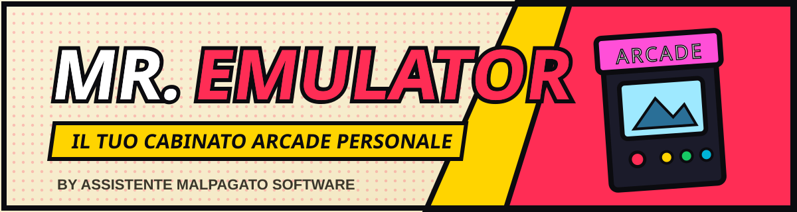
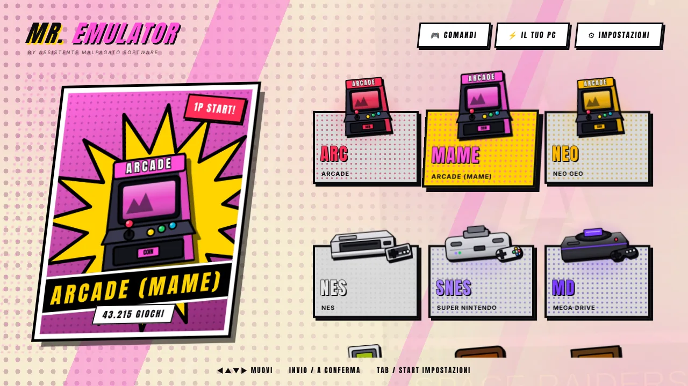
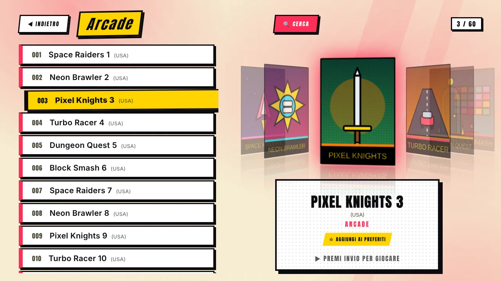
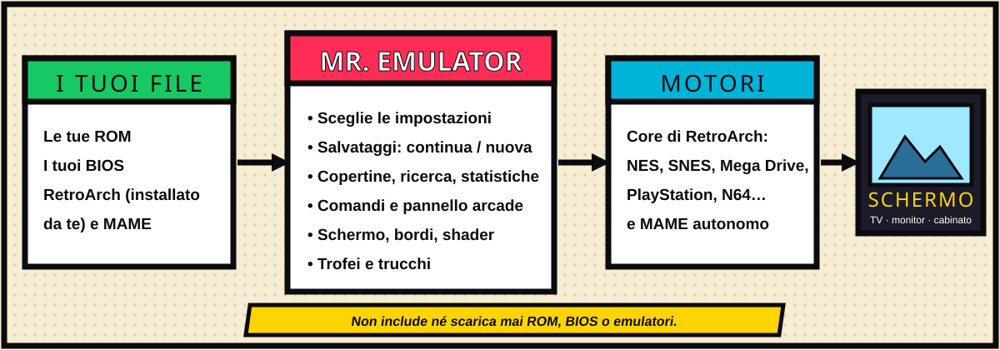

[English](Home) · **Italiano**

# Wiki di Mr. Emulator

Mr. Emulator è un **launcher gratuito per giochi arcade e console classiche su Windows**, pensato per chi vuole **giocare, non configurare**. Scegli un sistema, scegli un gioco, giochi. Dietro le quinte guida emulatori open source consolidati — i core di [RetroArch](https://www.retroarch.com/) e [MAME](https://www.mamedev.org/) autonomo — e li regola per il PC che hai davanti.

 

> **Non include, non scarica e non distribuisce ROM, BIOS o emulatori.** Usi i tuoi file ottenuti legalmente. Vedi [Privacy e note legali](IT-Privacy-e-Note-Legali).

## Perché un altro launcher?

| | |
|---|---|
| 🎯 **Zero configurazione** | Una guida al primo avvio crea le cartelle, trova RetroArch e MAME, scarica i core e controlla i BIOS. |
| ⚡ **Tarato sul tuo PC** | Riconosce CPU, scheda video e schermi e sceglie *Leggero / Bilanciato / Massimo* **per ogni sistema**, poi impara dalle tue risposte. Vedi [Autoguida](IT-Autoguida). |
| 💾 **Salvataggi che funzionano** | I progressi delle console si salvano all'uscita e ogni 10 secondi. Prima di un gioco con salvataggio scegli **Continua** o **Nuova partita**. Niente memory card. |
| 🕹️ **Pensato per i cabinati** | Preset per pannello arcade (I-PAC), uscita e menu senza tastiera, assegnazione manuale dei tasti per due giocatori, modalità cabinato. |
| 🎨 **Un aspetto tutto suo** | Uno stile **a fumetto** completo o uno stile **palcoscenico**, con console illustrate e le tue foto. |
| 🔎 **Ricerca istantanea** | Una tastiera intelligente che spegne le lettere inutili: veloce su 60.000 titoli e usabile con il joystick. |
| 🩺 **Diagnostica** | Una schermata dice cosa manca e come rimediare, e dà un testo da condividere. |

## Da dove cominciare

| Voglio… | Leggi |
|---|---|
| Installarlo e giocare la prima partita | [Primi passi](IT-Primi-Passi) |
| Vedere tutto quello che sa fare | [Tour delle funzioni](IT-Funzioni) |
| Sapere quali sistemi sono supportati e cosa servono | [Sistemi e BIOS](IT-Sistemi-e-BIOS) |
| Configurare tastiera, joypad o pannello arcade | [Comandi](IT-Comandi) |
| Sistemare barre nere, pixel, effetto CRT | [Schermo e qualità dell'immagine](IT-Schermo-e-Immagine) |
| Capire salvataggi, trofei e trucchi | [Salvataggi, trofei e trucchi](IT-Salvataggi-Trofei-Trucchi) |
| Gestire le copertine e la cache delle immagini | [Copertine e cache](IT-Copertine-e-Cache) |
| Confrontarlo con altri launcher, onestamente | [Confronto](IT-Confronto) |
| Risolvere un problema | [Problemi comuni](IT-Problemi-Comuni) |
| Contribuire o capire come è fatto | [Sotto il cofano](IT-Sotto-il-Cofano) |
| Cercare ogni impostazione | [Guida alle impostazioni](IT-Impostazioni) |
| Costruire o regolare un cabinato arcade | [Guida al cabinato](IT-Guida-al-Cabinato) |
| Risposte rapide | [Domande frequenti](IT-Domande-Frequenti) · [Glossario](IT-Glossario) |
| Vedere cosa è fatto e cosa viene dopo | [Roadmap e rilasci](IT-Roadmap-e-Rilasci) |

---
Mr. Emulator è rilasciato con licenza MIT ed è fatto da **Assistente Malpagato software**. Roadmap: [`docs/ROADMAP.md`](https://github.com/VjAlbert/Mr.Emulator/blob/main/docs/ROADMAP.md) · Note di rilascio: [`docs/RELEASE_NOTES.md`](https://github.com/VjAlbert/Mr.Emulator/blob/main/docs/RELEASE_NOTES.md).
