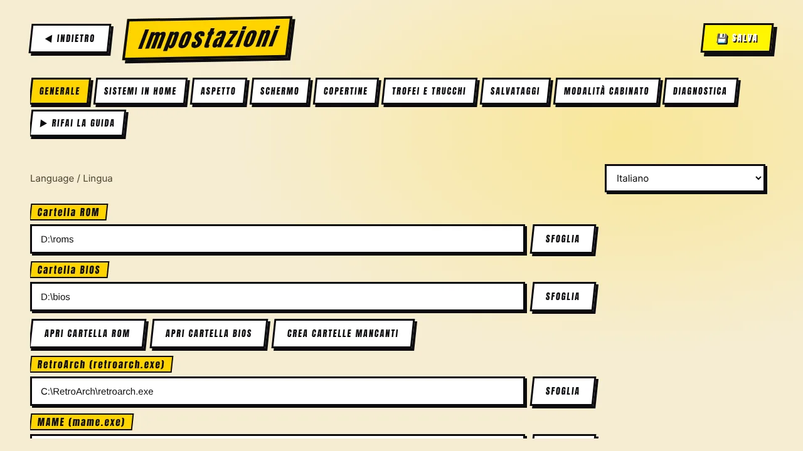
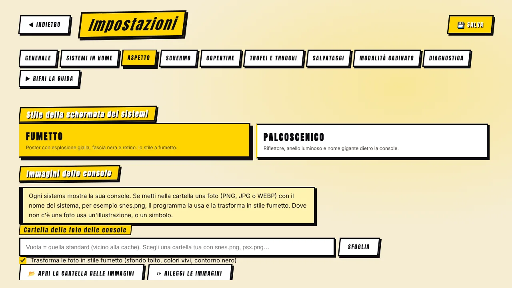

[◀ Home](IT-Home) · **Guida alle impostazioni**

# ⚙️ Guida alle impostazioni

 

Ogni opzione, scheda per scheda. Ricorda di premere **SALVA** dopo ogni modifica (i pulsanti che agiscono subito — sposta la cache, backup dei salvataggi, scarica i trucchi — non lo richiedono).

## Generale

| Opzione | Cosa fa |
|---|---|
| **Cartella ROM** / **Cartella BIOS** | Dove sono i tuoi giochi e i BIOS. *Crea cartelle mancanti* costruisce una sottocartella per sistema. *Usa un altro disco per tutto…* crea l'intera struttura di cartelle su un altro disco. |
| **RetroArch (retroarch.exe)** | Percorso di RetroArch. Pulsanti: *Sito ufficiale*, *Cerca sul PC* (guarda nei posti comuni) e *Sfoglia*. |
| **MAME (mame.exe)** | Percorso di MAME. *Verifica MAME* mostra la versione e quante macchine conosce. Usa la versione che corrisponde al tuo set di ROM. |
| **Cartella ROM di MAME / CHD** | Una cartella ROM dedicata a ogni versione di MAME (per esempio `mame0289`) e una cartella facoltativa per le immagini disco CHD. |
| **Cartella dei core** | Facoltativa. Vuota = la cartella `cores` accanto a RetroArch. |
| **Cartella DAT** | File DAT di FinalBurn Neo / Kawaks / MAME: nome breve → titolo vero per le console (ha la precedenza sulle Software List di MAME). |
| **Cartella immagini locali (Multimedia / EXTRAs)** | Il tuo pacchetto di immagini, video e musica. *Analizza* mostra cosa trova (copertine, schermate, filmati, colonna sonora). Usato sul posto — mai copiato. |
| **Mostra le varianti (cloni)** | Arcade (MAME): mostra anche le varianti di ogni gioco. |
| **Mostra i giochi che FBNeo non supporta** | Arcade / Neo Geo: mostra anche i giochi che il motore FinalBurn Neo non sa eseguire, come i set MAME completi. |
| **Giochi a più dischi** | Una voce per gioco per PlayStation, 3DO e Dreamcast; il cambio disco si fa dal menu di RetroArch. |
| **Avvia i giochi a schermo intero** | Avvia gli emulatori a schermo intero. |
| **Avviso nuova versione** | Una richiesta al giorno a GitHub; non si invia nulla di tuo. |
| **Suoni dell'interfaccia** | Bip da sala giochi. |
| **Filmato della partita sul gioco selezionato** | Serve la cartella `videosnaps` del pacchetto Multimedia. |
| **Volume della colonna sonora** | Per il lettore integrato. |
| **Sequenza INSERT COIN** | Prima di avviare un gioco; si salta con un pulsante. |
| **Rotazione di copertine a riposo** | Attract mode: dopo 1 minuto e mezzo (o quanto scegli) le copertine ruotano sullo schermo. |
| **Schermata iniziale** | Mostra la schermata «premi start» all'avvio. |
| **Effetti ridotti** | Meno animazioni e luci; consigliato per PC lenti. |
| **Controllo ROM (MAME)** | Trova gli ZIP difettosi con il verificatore di MAME. |
| **Ottimizzazione automatica del PC** | Rifà l'analisi dell'hardware (vedi *Il tuo PC*). |

## Sistemi in home

Scegli quali sistemi compaiono nella griglia della home. Nascondere un sistema non tocca le tue ROM. *Mostra tutti* e *Nascondi quelli senza giochi* sono scorciatoie. I sistemi segnati *in arrivo* non sono ancora giocabili.

## Aspetto

| Opzione | Cosa fa |
|---|---|
| **Stile della schermata dei sistemi** | *Fumetto* o *Palcoscenico*. Tutto il programma lo segue. |
| **Foto delle console** | Cartella da cui leggere le foto (vuota = quella standard accanto alla cache), *Apri la cartella*, *Rileggi*, e un elenco che mostra per ogni sistema se usa una foto, un'illustrazione o un simbolo. |
| **Trasforma le foto in stile fumetto** | Sfondo tolto, colori vivi, contorno nero. Togli la spunta per mostrare le foto così come sono. |
| **Tema del launcher** | Picchiaduro, Neon, Fosforo verde, Notte (solo colori). |

## Schermo

Modalità immagine per sistema, monitor verticale (MAME), bordi grafici (cartella, bordo comune, scelta per sistema), **nitidezza dei pixel** ed **effetto CRT**. Dettagli completi in [Schermo e immagine](IT-Schermo-e-Immagine).

## Copertine

Download automatico sì/no, scarica tutte le copertine di un sistema all'apertura, le schede per sistema e tutta la cassetta degli attrezzi della cache (spazio occupato, ottimizza, togli le copie, svuota, cartella della cache, sposta, limite di spazio). Vedi [Copertine e cache](IT-Copertine-e-Cache).

## Trofei e trucchi

Accesso a RetroAchievements e modalità hardcore; download del database dei trucchi e *carica da soli i trucchi del gioco*. Vedi [Salvataggi, trofei e trucchi](IT-Salvataggi-Trofei-Trucchi).

## Salvataggi

Cartella dei salvataggi, *Apri la cartella*, *Backup in uno ZIP*, *Ripristina da uno ZIP*, *Importa i salvataggi esistenti*; l'interruttore di ripresa delle console (generale e per console) e quello dei record di MAME.

## Modalità cabinato

Per usare il computer come un vero cabinato.

| Opzione | Cosa fa |
|---|---|
| **Schermo intero senza bordi** | Il launcher stesso gira a schermo intero senza bordi di finestra. |
| **Avvia con Windows** | Funziona nella versione installata. |
| **Nascondi il cursore del mouse** | Dopo qualche secondo senza muoverlo. |
| **Blocca la chiusura accidentale** | Alt+F4 non chiude più il programma. Si esce con **Ctrl + Maiusc + Q** o con il pulsante *Chiudi il programma*. |

## Diagnostica

I controlli, il pulsante *Copia il testo* e *Ricontrolla*. Vedi [Problemi comuni](IT-Problemi-Comuni).

## Rifai la guida

Rilancia la guida al primo avvio (è sempre l'ultima scheda).

[◀ Home](IT-Home) · [Avanti: Guida al cabinato ▶](IT-Guida-al-Cabinato)
