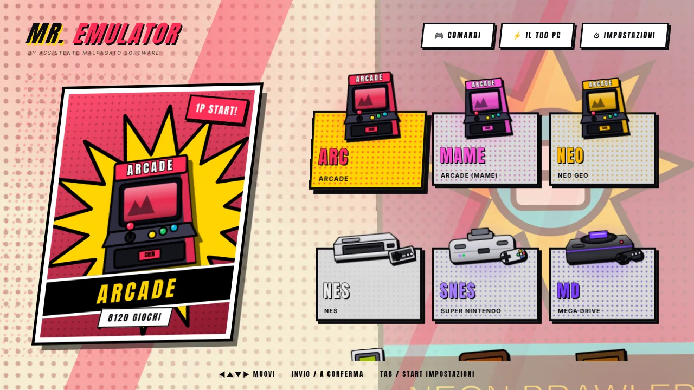
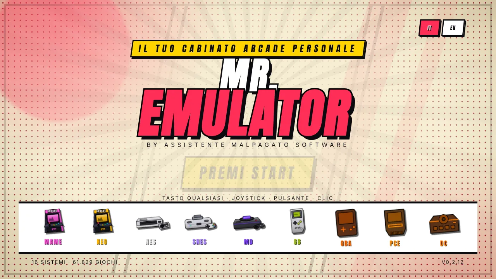
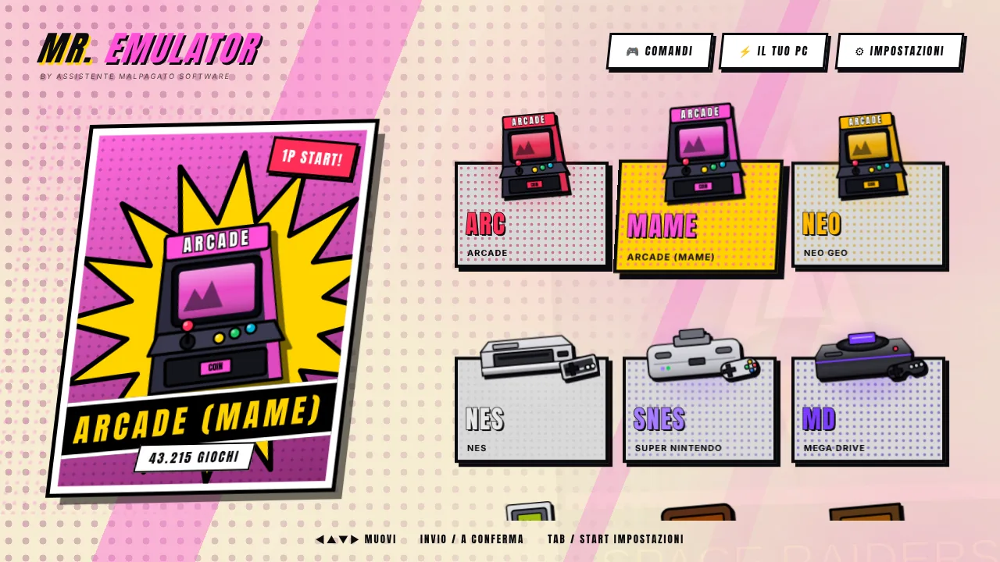

[◀ Home](IT-Home) · **Primi passi**

# 🚀 Primi passi

## 1. Installa

1. Scarica `Mr-Emulator-Setup-<versione>.exe` dall'[ultima release](https://github.com/VjAlbert/Mr.Emulator/releases/latest).
2. Avvialo. Windows può mostrare *«Windows ha protetto il PC»* perché il programma non ha ancora una firma digitale a pagamento: premi **Ulteriori informazioni → Esegui comunque**.
3. Apri Mr. Emulator: la **guida al primo avvio** parte da sola.

## 2. La guida, passo per passo

| Passo | Cosa fa | Cosa fai tu |
|---|---|---|
| **Cartella dei giochi** | Crea una sottocartella per sistema (`nes`, `snes`, `megadrive`, `psx`…) in `Documenti\MrEmulator` o sul disco che scegli. | Copia le tue ROM nelle cartelle. Scegli un altro disco se preferisci. |
| **RetroArch** | Cerca `retroarch.exe` nei posti comuni e te lo propone. | Se non lo trova, scaricalo da [retroarch.com](https://www.retroarch.com/) (Windows 64 bit, si estrae e basta) e premi **Sfoglia**. |
| **Core** | Con un clic scarica i core che ti servono dall'archivio ufficiale di libretro. | Spunta i sistemi che usi. |
| **BIOS** | Mostra l'elenco dei file necessari a ogni sistema e verifica quelli noti con il checksum. | Copia i BIOS mancanti nella cartella `bios`. |
| **MAME** *(facoltativo)* | Cerca `mame.exe` e mostra la versione. | Usa la **stessa versione di MAME del tuo set di ROM** — vedi sotto. |

Puoi saltare la guida e rifarla quando vuoi dal fondo delle **Impostazioni**.

> ⚠️ **MAME e il tuo set di ROM devono corrispondere.** Un set vale solo per la versione di MAME con cui è stato creato (un set 0.229 richiede MAME 0.229). Mr. Emulator avvisa se il nome della cartella delle ROM e la versione di MAME non coincidono. Le versioni ufficiali (anche vecchie) stanno su [mamedev.org](https://www.mamedev.org/release.html).

## 3. Gioca

1. Nella schermata iniziale premi un tasto, clicca o premi un pulsante del joystick.
2. Scegli un sistema con le frecce (o mouse / pad).
3. Scegli un gioco. A destra vedi la copertina, il titolo e — se c'è un salvataggio — l'interruttore **Continua / Nuova partita**.
4. **Invio** (o pulsante 1) per avviare. Si esce con **Esc**, oppure **Select + Start** sul gamepad.

 

## 4. Rendilo tuo

- **Impostazioni → Aspetto** — stile fumetto o palcoscenico, colori, le tue foto delle console.
- **Impostazioni → Sistemi in home** — nascondi i sistemi che non usi.
- **Impostazioni → Copertine** — scarica le copertine di un intero sistema con un clic.
- **Il tuo PC** — vedi cosa ha riconosciuto il programma e forza un livello di prestazioni se vuoi.

## Qualcosa non va?

Apri **Impostazioni → Diagnostica**: controlla cartelle, core, BIOS e l'ultimo registro di RetroArch, e ti dice cosa fare. Vedi [Problemi comuni](IT-Problemi-Comuni).

[Avanti: Tour delle funzioni ▶](IT-Funzioni)
