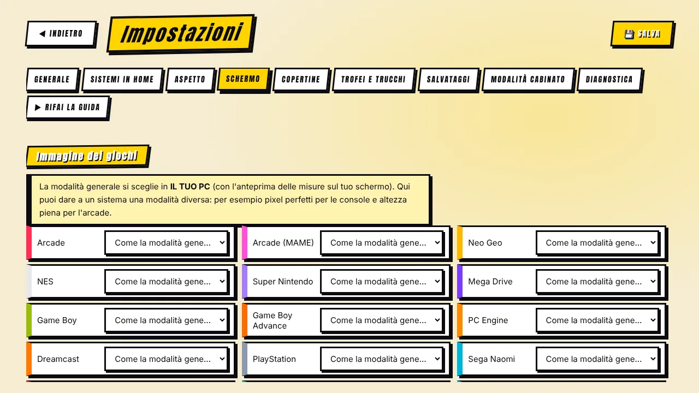

[◀ Home](IT-Home) · **Schermo e immagine**

# 🖥️ Schermo e qualità dell'immagine

Tutto sta in **Il tuo PC** (modalità generale) e in **Impostazioni → Schermo**.

## Le quattro modalità

La modalità generale si sceglie in **Il tuo PC**, con un'anteprima che usa le misure reali del **tuo** schermo. In **Impostazioni → Schermo** puoi dare a un sistema una modalità diversa — per esempio pixel perfetti per le console e altezza piena per l'arcade.

| Modalità | Cosa ottieni | Adatta a |
|---|---|---|
| **Altezza piena** | Il gioco occupa tutta l'altezza dello schermo con le proporzioni originali. Nitido e il più grande possibile. | La maggior parte dei giochi sulla maggior parte degli schermi. |
| **Pixel perfetti** | Solo ingrandimenti interi (×4, ×5…): ogni pixel è un quadrato perfetto. Un po' più piccolo. | I puristi; schermi con altezza multipla di 224/240. |
| **Pixel perfetti in altezza** | Altezza a multipli interi, larghezza libera. | Nitido in verticale, quasi a tutta altezza. |
| **Tutto schermo (stirato)** | Riempie tutto lo schermo ma deforma l'immagine (i cerchi diventano ovali). | Quando le proporzioni non contano. |

La maggior parte dei giochi arcade e console è 4:3: su un widescreen ha barre laterali, a meno che tu non la stiri o usi un bordo.

> Da sapere: i pixel perfetti rendono al meglio se l'altezza dello schermo è multipla delle righe del gioco — **1920×1200 (×5)**, **2560×1440 (×6)**, **4K (×9)**.

## Bordi (overlay)

**Impostazioni → Schermo → Bordo grafico** riempie le barre laterali con una grafica (overlay di RetroArch).

1. Attiva *Riempi le strisce laterali con un bordo grafico*.
2. Scegli la cartella dove tieni gli overlay `.cfg` (si cerca anche nelle sottocartelle).
3. Il programma **abbina un bordo a ogni sistema dal nome** e mostra quanti ne ha abbinati. Puoi cambiare un sistema a mano, scegliere «nessun bordo», o indicare un bordo comune per tutti gli altri.

In *Tutto schermo (stirato)* il bordo si spegne da solo, perché coprirebbe i lati dell'immagine.

## Effetto CRT

**Impostazioni → Schermo → Effetto CRT** sceglie uno shader di RetroArch: *Automatico* (predefinito), *Nessuno*, *Easymode* (leggero), *Geom* (classico con curvatura), *Lottes* (morbido) o *Royale* (molto realistico, richiede una scheda potente).

*Automatico* sceglie in base all'hardware e al sistema: nessun effetto al livello Leggero, sui sistemi pesanti o su schermi sotto i 900 px di altezza; solo lo shader più leggero su 4K senza scheda potente. Gli shader devono essere installati: in RetroArch → **Aggiornamenti online → Aggiorna shader Slang**.

## Nitidezza dei pixel

**Impostazioni → Schermo → Nitidezza dei pixel** migliora l'aspetto dei pixel ingranditi:

| Opzione | Cosa fa | Costo |
|---|---|---|
| **Nessuna** | Pixel come sono. | — |
| **Morbida** | `sharp-bilinear`: bordi dei pixel più dolci. | Leggerissima — sempre offerta. |
| **Alta qualità** | `xBRZ`: linee oblique pulite. | Serve una scheda video adeguata; offerta solo se il PC la regge. |

Un'opzione è **offerta solo se la macchina la regge e lo shader è installato**; se un sistema è troppo pesante il programma scende da solo di un gradino. Con l'effetto CRT su *Automatico* la nitidezza ha la precedenza (le righe del CRT la nasconderebbero); scegli un CRT a mano per averli insieme — vengono uniti in un solo preset.

L'effetto si vede meglio in **Altezza piena** sulle console a 8/16 bit. Vale per i giochi RetroArch, non per MAME.

## Monitor verticali (MAME)

Se il monitor è montato ruotato, scegli **senso orario** o **antiorario** in **Impostazioni → Schermo**, così gli sparatutto verticali sfruttano tutto lo schermo (ruota lo schermo anche da Windows).

## Come arrivano le impostazioni agli emulatori

Per ogni gioco il programma scrive un piccolo file di configurazione: RetroArch lo riceve con `--appendconfig` (proporzione, scala intera, overlay, shader…), MAME riceve un `mame.ini` generato. Scrive sempre i valori di proporzione e scala, anche quando sono «normali», e dice a RetroArch di **non salvare la propria configurazione all'uscita** — altrimenti RetroArch ricorderebbe l'ultima modalità (per esempio *stirata*) e la applicherebbe al gioco dopo.

[◀ Comandi](IT-Comandi) · [Avanti: Salvataggi, trofei e trucchi ▶](IT-Salvataggi-Trofei-Trucchi)
