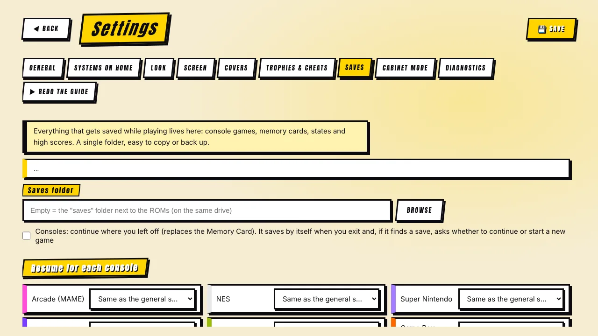
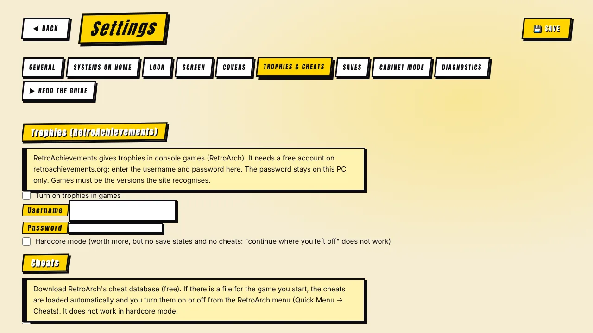

[◀ Home](Home.md) · **Saves, trophies & cheats**

# 💾 Saves, trophies & cheats

 

## Saves — "Continue" instead of memory cards

There is **one saves folder**, next to your ROM folder by default (for example `D:\saves`) or wherever you choose in **Settings → Saves**. It holds console saves, memory cards, states and MAME high scores — easy to copy or back up.

### Consoles

- Progress is written **when you exit and every 10 seconds** (so a power cut costs almost nothing).
- Before launching a game that has a save, a window asks: **Continue** or **New game**. "New game" keeps the old save as a safety copy (`.prev`).
- This **replaces the memory card** on systems such as the PlayStation.
- You can switch the behaviour on or off **for each console** in *Settings → Saves*, or use the general switch.

### Arcade

- In the game preview, switch **New game / Resume** with ◀ ▶ — per game.
- **MAME high scores** are kept for supported games.

### Backup and restore

*Settings → Saves* can open the folder, **back up everything to a ZIP**, **restore** it, and **import** existing RetroArch saves and the previous MAME location.

> Saves live in states and SRAM written by RetroArch/MAME. They are **not portable between different emulator versions**: keep a backup before updating a core.

## Trophies — RetroAchievements

*Settings → Trophies & cheats* lets you log in to your **free** [RetroAchievements](https://retroachievements.org/) account. Games launched through RetroArch then award trophies.

- **Hardcore mode** is optional: trophies are worth more, but **save states and cheats are disabled** by the site's rules — so the "continue where you left off" feature does not work in hardcore.
- The game must be a version the site recognises; otherwise RetroArch logs *"Unknown game"*.
- Your password stays **on this PC** (see [Privacy & legal](Privacy-and-Legal.md)).

## Cheats

One click downloads RetroArch's **cheat database** into a `cheats` folder next to your ROM folder, with a progress bar. When you launch a game and there is a file for it, the program copies it where RetroArch looks and turns on *apply cheats after load*; you switch individual cheats on or off from RetroArch's menu (Quick Menu → Cheats).

- It matches by game title, so region tags like *(Europe)* still find the *(USA)* file.
- It does nothing with hardcore mode on.
- MAME has its own cheats in its internal menu.

[◀ Screen & image quality](Screen-and-Image.md) · [Next: Covers & image cache ▶](Covers-and-Cache.md)
