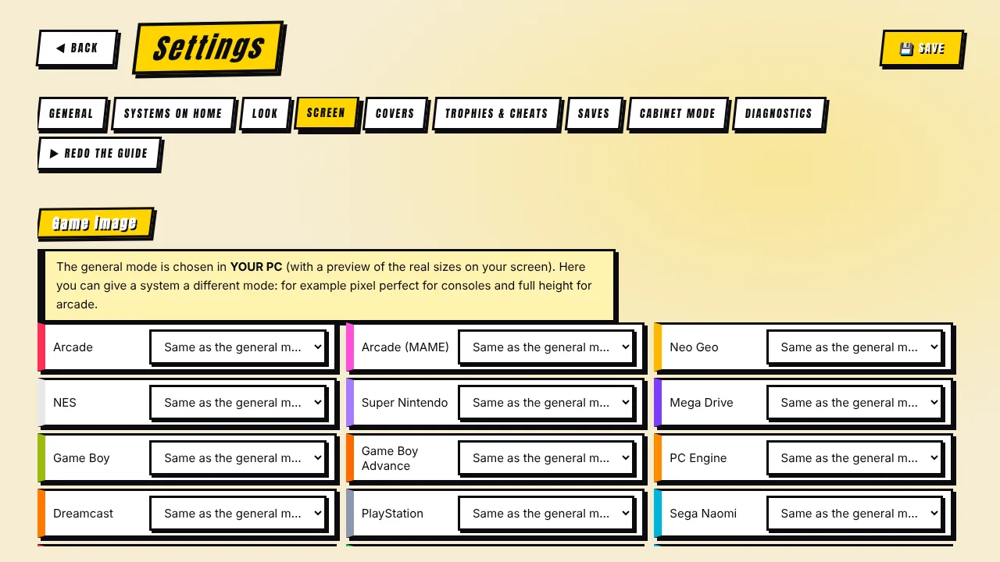

[◀ Home](Home.md) · **Screen & image quality**

# 🖥️ Screen & image quality

Everything here lives in **Your PC** (general mode) and **Settings → Screen**.

## The four image modes

Choose the general mode in **Your PC**; it shows a live preview with the real size of **your** screen. In **Settings → Screen** you can give a system a different mode — for example pixel-perfect for consoles and full height for arcade.

| Mode | What you get | Good for |
|---|---|---|
| **Full height** | The game fills the screen height with the original proportions. Sharp and as big as possible. | Most games on most screens. |
| **Pixel perfect** | Whole-number scaling only (×4, ×5…): every pixel is a perfect square. A bit smaller. | Purists; screens whose height is a multiple of 224/240. |
| **Pixel perfect in height** | Whole-number height, free width. | Crisp vertically, almost full height. |
| **Full screen (stretched)** | Fills the whole screen but deforms the picture (circles become ovals). | When you do not care about proportions. |

Most arcade and console games are 4:3: on a widescreen they have side bars unless you stretch them or use a border.

> Good to know: pixel-perfect works best when the screen height is a multiple of the game's lines — **1920×1200 (×5)**, **2560×1440 (×6)**, **4K (×9)**.

## Borders (overlays)

**Settings → Screen → Graphic border** fills the side bars with artwork (RetroArch overlays).

1. Turn on *Fill the side bars with a graphic border*.
2. Choose the folder where you keep the `.cfg` overlays (sub-folders are searched too).
3. The program **matches a border to each system by name** and shows how many it matched. You can override a system by hand, pick "no border", or set one shared border for everything else.

In *Full screen (stretched)* the border is switched off automatically, because it would cover the sides of the picture.

## CRT effect

**Settings → Screen → CRT effect** picks a RetroArch shader: *Automatic* (default), *None*, *Easymode* (light), *Geom* (classic with curvature), *Lottes* (soft) or *Royale* (very realistic, needs a strong card).

*Automatic* chooses by your hardware and the system: no effect on the Light level, on heavy systems, or on screens under 900 px tall; only the lightest shader on 4K without a strong graphics card. Shaders must be installed: in RetroArch → **Online Updater → Update Slang Shaders**.

## Pixel sharpness

**Settings → Screen → Pixel sharpness** improves how enlarged pixels look:

| Option | What it does | Cost |
|---|---|---|
| **None** | Pixels as they are. | — |
| **Soft** | `sharp-bilinear`: smoother pixel edges. | Very light — always offered. |
| **High quality** | `xBRZ`: clean diagonal lines. | Needs a decent graphics card; offered only if your PC can take it. |

An option is **offered only if the machine can handle it and the shader is installed**; if a system is too heavy the program steps down one level by itself. With the CRT effect on *Automatic*, sharpness takes priority (the CRT lines would hide it); pick a CRT by hand to have both — they are merged into a single preset.

The effect is most visible in **Full height** on 8/16-bit consoles. It applies to RetroArch games, not to MAME.

## Vertical monitors (MAME)

If your monitor is mounted rotated, choose **clockwise** or **counter-clockwise** in **Settings → Screen** so vertical shoot'em-ups use the whole screen (rotate the screen in Windows too).

## How the settings reach the emulators

For every game the program writes a small config file: RetroArch receives it with `--appendconfig` (aspect, integer scaling, overlay, shader…), MAME gets a generated `mame.ini`. It always writes the aspect and scaling values, even when they are "normal", and tells RetroArch **not to save its own config on exit** — otherwise RetroArch would remember the last mode (for example *stretched*) and apply it to the next game.

[◀ Controls](Controls.md) · [Next: Saves, trophies & cheats ▶](Saves-Trophies-Cheats.md)
