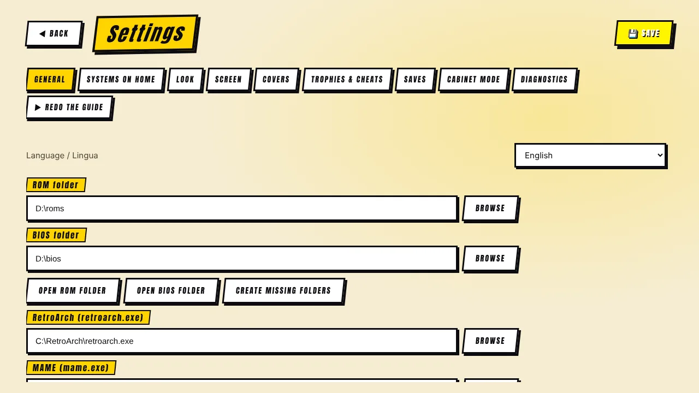
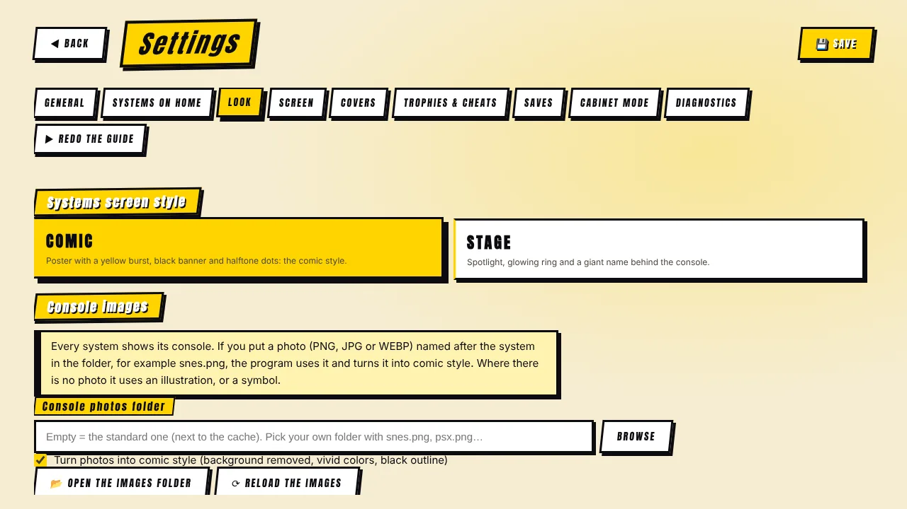

[◀ Home](Home) · **Settings reference**

# ⚙️ Settings reference

 

Every option, tab by tab. Remember to press **SAVE** after changing anything (the buttons that act immediately — move the cache, back up saves, download cheats — do not need it).

## General

| Option | What it does |
|---|---|
| **ROM folder** / **BIOS folder** | Where your games and BIOS files are. *Create missing folders* builds one sub-folder per system. *Use another drive for everything…* creates the whole folder structure on another disk. |
| **RetroArch (retroarch.exe)** | Path to RetroArch. Buttons: *Official site*, *Search this PC* (looks in the usual places) and *Browse*. |
| **MAME (mame.exe)** | Path to MAME. *Check MAME* shows its version and how many machines it knows. Use the version that matches your ROM set. |
| **MAME ROM folder / CHD folder** | A dedicated ROM folder per MAME version (for example `mame0289`), and an optional folder for CHD disk images. |
| **Cores folder** | Optional. Empty = the `cores` folder next to RetroArch. |
| **DAT folder** | FinalBurn Neo / Kawaks / MAME DAT files: short name → real title for consoles (takes precedence over the MAME Software Lists). |
| **Local images folder (Multimedia / EXTRAs)** | Your image/video/music pack. *Analyze* shows what it found (covers, screenshots, videos, soundtrack). Used in place — never copied. |
| **Show variants (clones)** | Arcade (MAME): also list the variants of each game. |
| **Show games FBNeo does not support** | Arcade / Neo Geo: also list games the FinalBurn Neo engine cannot run, like complete MAME sets. |
| **Multi-disc games** | One entry per game for PlayStation, 3DO and Dreamcast; swap discs from RetroArch's menu. |
| **Start games full screen** | Launch emulators in full screen. |
| **Update notice** | One request a day to GitHub; nothing about you is sent. |
| **Interface sounds** | Arcade-style beeps. |
| **Game video on the selected game** | Needs the `videosnaps` folder of the Multimedia pack. |
| **Soundtrack volume** | For the built-in player. |
| **INSERT COIN sequence** | Shown before a game starts; skip with a button. |
| **Cover rotation when idle** | Attract mode: after 1 minute 30 s (or your choice) covers rotate on screen. |
| **Title screen** | Show the "press start" screen at launch. |
| **Reduced effects** | Fewer animations and lights; recommended for slow PCs. |
| **ROM check (MAME)** | Finds broken ZIPs with MAME's verifier. |
| **Automatic PC optimization** | Run the hardware analysis again (see *Your PC*). |

## Systems on home

Choose which systems appear on the home grid. Hiding a system does not touch your ROMs. *Show all* and *Hide the ones without games* are shortcuts. Systems still marked *coming soon* are not playable yet.

## Look

| Option | What it does |
|---|---|
| **Systems screen style** | *Comic* or *Stage*. The whole program follows it. |
| **Console photos** | Folder to read photos from (empty = the standard one next to the cache), *Open the folder*, *Reload*, and a list showing for each system whether it uses a photo, an illustration or a symbol. |
| **Turn photos into comic style** | Background removed, vivid colours, black outline. Untick to show photos as they are. |
| **Launcher theme** | Fighter, Neon, Green phosphor, Night (colours only). |

## Screen

Per-system image mode, vertical monitor (MAME), graphic borders (folder, shared border, per-system choice), **pixel sharpness** and the **CRT effect**. Full details in [Screen & image quality](Screen-and-Image).

## Covers

Automatic download on/off, download all covers of a system when you open it, the per-system cards, and the whole image-cache toolbox (space used, optimize, remove pack copies, empty, cache folder, move, size limit). See [Covers & image cache](Covers-and-Cache).

## Trophies & cheats

RetroAchievements login and hardcore mode; cheat database download and *load the game's cheats by themselves*. See [Saves, trophies & cheats](Saves-Trophies-Cheats).

## Saves

Saves folder, *Open the folder*, *Back up to a ZIP*, *Restore from a ZIP*, *Import existing saves*; the console-resume switch (general and per console) and the MAME high-score switch.

## Cabinet mode

For using the PC as a real arcade cabinet.

| Option | What it does |
|---|---|
| **Borderless full screen** | The launcher itself runs full screen without window borders. |
| **Start with Windows** | Works in the installed version. |
| **Hide the mouse cursor** | After a few seconds without moving it. |
| **Block accidental closing** | Alt+F4 no longer closes the program. Exit with **Ctrl + Shift + Q** or the *Close the program* button. |

## Diagnostics

The checks, a *Copy the text* button and *Check again*. See [Troubleshooting](Troubleshooting).

## Redo the guide

Runs the first-run guide again (always the last tab).

[◀ Home](Home) · [Next: Cabinet guide ▶](Cabinet-Guide)
