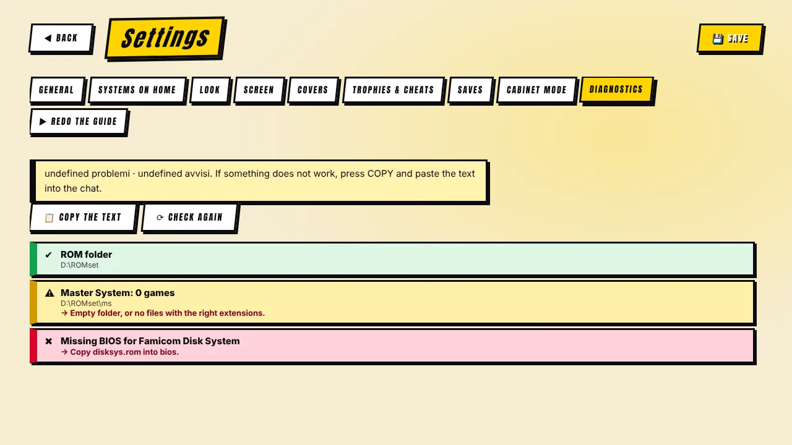

[◀ Home](Home) · **Troubleshooting**

# 🩺 Troubleshooting

**Start with Settings → Diagnostics.** It marks every check as ✔ OK, ⚠ attention or ✖ problem, and tells you how to fix it. Press **Copy the text** to share the full report (it also includes the last RetroArch/MAME logs and the image settings requested at the last game).

## Common problems

| Symptom | Likely cause | Fix |
|---|---|---|
| A system shows **0 games** | Wrong folder or extensions | Check the folder name in [Systems & BIOS](Systems); put files directly in it. |
| **RetroArch not found** | Path not set | Settings → General → *Search this PC* / Browse to `retroarch.exe`. |
| **Missing core** | Core not downloaded | First-run guide or Diagnostics → install the core, or RetroArch → Load Core → Download a Core. |
| **Missing BIOS** | File not in `bios` | See the table in [Systems & BIOS](Systems). Diagnostics says which file and where. |
| **MAME game will not start** | ROM set and MAME version differ, or a ZIP is incomplete | Use the MAME version of your set. Use **ROM check**; the failure notice names the missing/bad files. Click the notice to copy details. |
| Game always looks **full height** whatever mode I choose | Older versions: RetroArch remembered the last aspect; or a graphic border covers the sides | Update (fixed in 0.2.6/0.2.4). In *Full screen (stretched)* borders are switched off automatically. |
| **Border not found** | Names do not match | Settings → Screen: see "Borders matched automatically: N of M"; pick the border by hand for the others. Remember to turn the option on and press **Save**. |
| **Pixel sharpness has no effect** | Shader not installed, option not offered, or CRT lines hide it | RetroArch → Online Updater → Update Slang Shaders. The option is greyed out with the reason if your PC cannot take it. Use *Full height* on a 16-bit console to see it best. |
| **Covers missing** | Not downloaded yet, or none online | Settings → Covers → *Find covers…* The card shows how many are "not available online". |
| **Cache too big / on drive C:** | Old versions copied pack images | Settings → Covers → Space used: *Remove pack copies*, *Optimize*, then choose another folder and *Move the cache here*. |
| **Resume does not continue** | Resume off for that console, hardcore mode on, or the core cannot save states | Settings → Saves (per-console switch). Hardcore disables states. |
| **Choppy screen changes** | A slow GPU with heavy effects | Turn on the *reduced effects* option in Settings → General. Update to the latest version (it removed some heavy effects). |
| Windows shows **"protected your PC"** | The installer is not signed yet | More info → Run anyway. Signing is on the roadmap. |

## What to send when you report a bug

1. The **Diagnostics text** (Copy the text).
2. Your **RetroArch version** and **MAME version**.
3. What you did, what you expected, what happened. A screenshot helps.

Open an [issue](https://github.com/VjAlbert/Mr.Emulator/issues) on GitHub.

[◀ Comparison](Comparison) · [Next: Privacy & legal ▶](Privacy-and-Legal)
