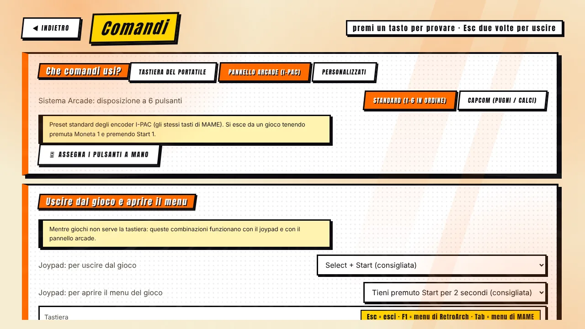

[◀ Home](Home.md) · **Comandi**

# 🕹️ Comandi

Mr. Emulator si usa interamente con **tastiera, mouse, gamepad o pannello arcade**, e scrive le impostazioni dei comandi per RetroArch **e** per MAME: quello che configuri una volta vale ovunque.

## Preset

| Preset | Per | Note |
|---|---|---|
| **Tastiera portatile** | Giocare con la tastiera | WASD + J / K / L e simili per il giocatore 1, frecce e tastierino numerico per il 2. |
| **Pannello arcade (I-PAC)** | Un cabinato con encoder tipo I-PAC | Due giocatori, sei pulsanti ciascuno, gli stessi tasti di MAME. |
| **Personalizzato** | Qualsiasi altro caso | La tua assegnazione (vedi sotto). |

Per il sistema arcade ci sono due disposizioni dei pulsanti: **Standard** (1–6 in ordine) e **Capcom** (tre pugni, tre calci).

## Assegnazione manuale

**Comandi → Assegna i pulsanti a mano** ti guida su ogni azione per due giocatori: premi il tasto o il pulsante, o muovi l'asse che vuoi. Controlla i conflitti e funziona con tastiere, gamepad ed encoder. L'assegnazione vale per RetroArch, per MAME e per il menu del programma.

Sono coperti anche i gamepad non Xbox: cloni PS3 con più di sei pulsanti, **L1 / R1 / L2 / R2 / L3 / R3**, croci direzionali riportate come «hat» e grilletti analogici.

## Prova i tuoi dispositivi

La schermata **Comandi** mostra in tempo reale cosa fa ogni tasto, pulsante o asse, così puoi controllare un encoder o un pad nuovo prima di avviare un gioco.

## Navigazione nel launcher

| Azione | Tastiera | Gamepad / pannello |
|---|---|---|
| Muoversi | Frecce | Croce o stick |
| Confermare | Invio | Pulsante 1 |
| Indietro | Esc | Pulsante 2 |
| Cerca | `/` | Y (pad) · pulsante 4 (pannello) |
| Preferito | F2 | — |
| Colonna sonora | F3 | — |
| Impostazioni | Tab | Start |

## Uscita e menu di gioco — senza tastiera

| | Uscire dal gioco | Menu di gioco |
|---|---|---|
| **Tastiera** | `Esc` | `F1` (RetroArch) · `Tab` (MAME) |
| **Pannello arcade (I-PAC)** | tieni **Moneta 1** + premi **Start 1** | tieni **Moneta 1** + premi **Pulsante 1** |
| **Gamepad (Xbox, PlayStation, 8BitDo…)** | **Select + Start** | tieni **Start** per 2 s (RetroArch) · **Select + A** (MAME) |

Le combinazioni del gamepad si possono cambiare — o disattivare — in **Comandi → Uscire dal gioco e aprire il menu**. In MAME il menu dà accesso a DIP switch, assegnazione dei comandi, modalità servizio e reset. Sui pad Xbox, Start e Moneta di MAME usano i veri pulsanti Start/Back.

## Consigli per i cabinati

- Attiva la **Modalità cabinato** (Impostazioni): avvio con Windows, schermo intero senza bordi, cursore nascosto e uscita protetta.
- Tieni la combinazione di uscita *standard* sul pannello, così un ospite può sempre lasciare un gioco senza tastiera.

[◀ Sistemi e BIOS](Systems.md) · [Avanti: Schermo e immagine ▶](Screen-and-Image.md)
