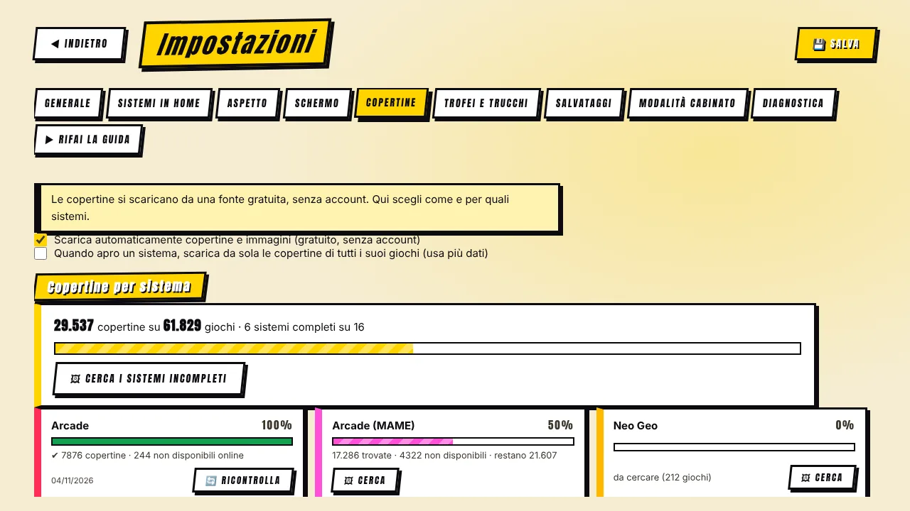

[◀ Home](Home.md) · **Copertine e cache**

# 🖼️ Copertine e cache delle immagini

## Da dove arrivano

Copertine e screenshot vengono dall'archivio gratuito **libretro-thumbnails** — nessun account, nessuna API a pagamento. Il programma cerca la lista ufficiale di ogni sistema e sceglie il file giusto **anche se i nomi dei tuoi file sono diversi** (regioni, dischi, «Zelda, The»…). Se non esiste nulla, genera una copertina a fumetto (titolo, sistema, anno).

Ordine di preferenza per ogni immagine:

1. **I tuoi pacchetti Multimedia** (snap, flyers, titles) se indichi una cartella — usati **sul posto**, mai copiati.
2. La cache locale.
3. Un download (solo se è attivo nelle Impostazioni).

## Impostazioni → Copertine

- **Riepilogo** — «29.537 copertine su 61.829 giochi · 6 sistemi completi su 16».
- **Una scheda per sistema** con barra di avanzamento: quante copertine trovate, quante **non disponibili online** (cercate una volta, non ritentate a ogni avvio), quante restano, e la data dell'ultima ricerca completa.
- **Cerca i sistemi incompleti** li esegue uno dopo l'altro; **Ferma tutto** annulla.
- Facoltativo: il programma scarica tutte le copertine di un sistema quando lo apri (usa più dati).

## La cache delle immagini

Le immagini stanno in una cache. In **Impostazioni → Copertine → Spazio occupato dalle immagini** puoi:

| Strumento | Cosa fa |
|---|---|
| **Dove tenere la cache** | Scegli una cartella (per esempio su un altro disco). Dentro si crea `MrEmulator-artwork`. **Sposta la cache qui** porta lì le immagini già scaricate — e le foto delle console — con una barra di avanzamento, e toglie la vecchia copia solo a operazione riuscita. |
| **Ottimizza (comprimi)** | Ricomprime le immagini già in cache (max 640 px, JPEG). Riscrive un file solo se diventa più piccolo. |
| **Togli le copie dei pacchetti** | Cancella le copie di immagini dei pacchetti Multimedia fatte dalle versioni vecchie. |
| **Svuota tutto** | Cancella ogni immagine scaricata; gli indici restano. |
| **Limite di spazio** | Facoltativo (1–20 GB): oltre il limite si tolgono le immagini più vecchie. Predefinito: nessun limite. |

I nuovi download sono già salvati **ridimensionati e compressi**, di solito poche decine di KB invece di centinaia. Le immagini dei tuoi pacchetti Multimedia non vengono più copiate nella cache.

## Le tue foto delle console

Ogni sistema mostra la sua console. Metti un PNG/JPG/WEBP con il nome del sistema (`snes.png`, `psx.png`…) nella cartella delle foto (**Impostazioni → Aspetto**, puoi scegliere qualsiasi cartella) e il programma lo trasforma in stile fumetto — oppure lo mostra com'è (togli la spunta a *Trasforma le foto in stile fumetto*). Dove non c'è una foto usa un'illustrazione, o un simbolo.

Le foto devono essere **tue o di pubblico dominio**, meglio su sfondo bianco o trasparente, larghe circa 800 px.

[◀ Salvataggi, trofei e trucchi](Saves-Trophies-Cheats.md) · [Avanti: Autoguida ▶](Auto-Tuning.md)
