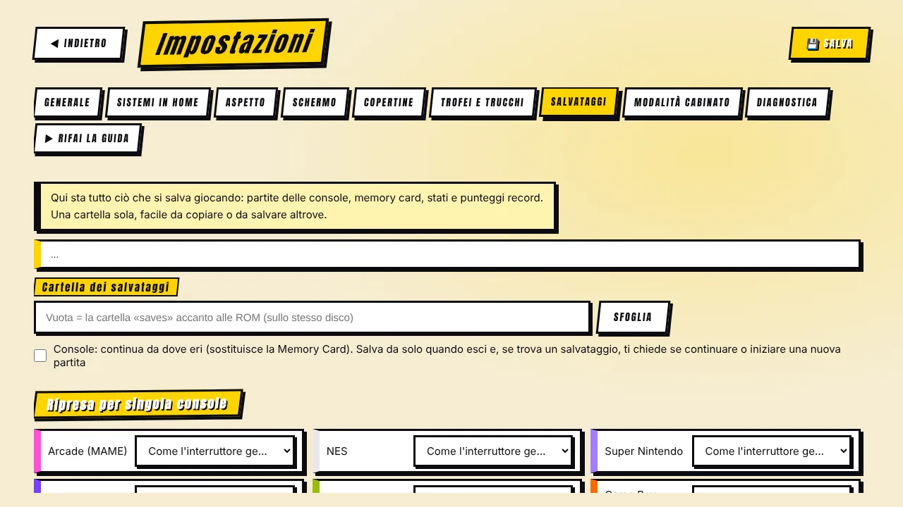
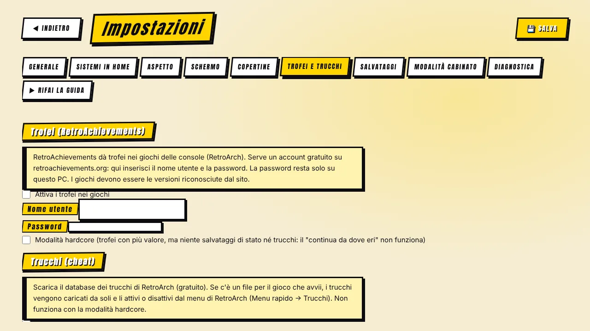

[◀ Home](Home.md) · **Salvataggi, trofei e trucchi**

# 💾 Salvataggi, trofei e trucchi

 

## Salvataggi — «Continua» al posto delle memory card

C'è **una sola cartella dei salvataggi**, per impostazione accanto alla cartella delle ROM (per esempio `D:\saves`) o dove scegli in **Impostazioni → Salvataggi**. Contiene salvataggi delle console, memory card, stati e punteggi record di MAME — facile da copiare o da salvare altrove.

### Console

- I progressi si scrivono **all'uscita e ogni 10 secondi** (una caduta di corrente costa pochissimo).
- Prima di un gioco con salvataggio una finestra chiede: **Continua** o **Nuova partita**. «Nuova partita» conserva il vecchio salvataggio come copia di sicurezza (`.prev`).
- Questo **sostituisce la memory card** su sistemi come la PlayStation.
- Puoi attivare o spegnere il comportamento **per ogni console** in *Impostazioni → Salvataggi*, oppure usare l'interruttore generale.

### Arcade

- Nell'anteprima del gioco, cambia **Nuova partita / Riprendi** con ◀ ▶ — gioco per gioco.
- I **record di MAME** si conservano per i giochi che lo permettono.

### Backup e ripristino

*Impostazioni → Salvataggi* può aprire la cartella, fare il **backup di tutto in un ZIP**, **ripristinarlo** e **importare** i salvataggi di RetroArch già esistenti e la posizione precedente di MAME.

> I salvataggi sono stati e SRAM scritti da RetroArch/MAME. **Non sono portabili tra versioni diverse** dell'emulatore: fai un backup prima di aggiornare un core.

## Trofei — RetroAchievements

*Impostazioni → Trofei e trucchi* permette di accedere al tuo account **gratuito** di [RetroAchievements](https://retroachievements.org/). I giochi avviati con RetroArch assegnano poi i trofei.

- La **modalità hardcore** è facoltativa: i trofei valgono di più, ma per le regole del sito **stati di salvataggio e trucchi sono disattivati** — quindi il «continua da dove eri» non funziona in hardcore.
- Il gioco deve essere una versione riconosciuta dal sito; altrimenti RetroArch scrive *«Unknown game»* nel registro.
- La password resta **su questo PC** (vedi [Privacy e note legali](Privacy-and-Legal.md)).

## Trucchi

Un clic scarica il **database dei trucchi** di RetroArch in una cartella `cheats` accanto a quella delle ROM, con una barra di avanzamento. Quando avvii un gioco e c'è un file per lui, il programma lo copia dove lo cerca RetroArch e attiva *applica i trucchi dopo il caricamento*; accendi o spegni i singoli trucchi dal menu di RetroArch (Menu rapido → Trucchi).

- L'abbinamento è per titolo, quindi un tag di regione come *(Europe)* trova comunque il file *(USA)*.
- Non fa nulla con la modalità hardcore attiva.
- MAME ha i suoi trucchi nel menu interno.

[◀ Schermo e immagine](Screen-and-Image.md) · [Avanti: Copertine e cache ▶](Covers-and-Cache.md)
