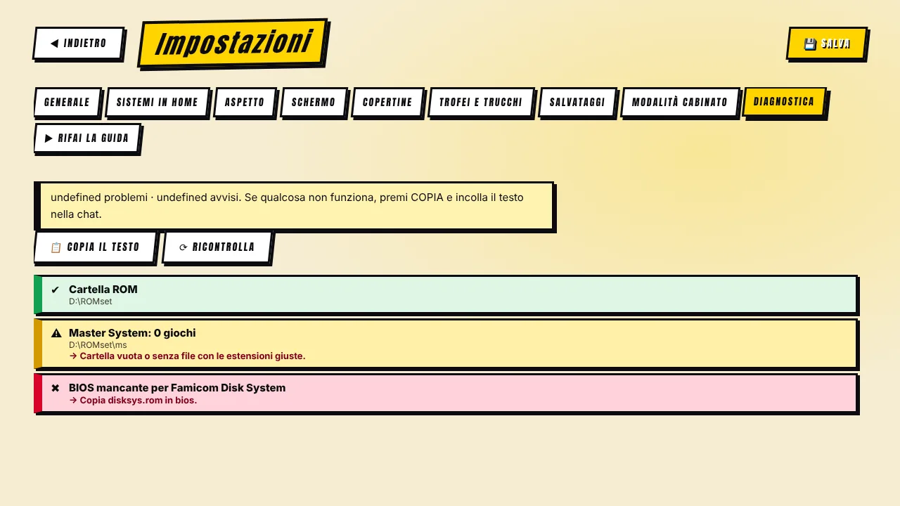

[◀ Home](Home.md) · **Problemi comuni**

# 🩺 Problemi comuni

**Comincia da Impostazioni → Diagnostica.** Segna ogni controllo come ✔ OK, ⚠ attenzione o ✖ problema e dice come rimediare. Premi **Copia il testo** per condividere il rapporto completo (include anche gli ultimi registri di RetroArch/MAME e le impostazioni dell'immagine richieste all'ultimo gioco).

## Problemi frequenti

| Sintomo | Causa probabile | Rimedio |
|---|---|---|
| Un sistema mostra **0 giochi** | Cartella o estensioni sbagliate | Controlla il nome della cartella in [Sistemi e BIOS](Systems.md); metti i file direttamente dentro. |
| **RetroArch non trovato** | Percorso non indicato | Impostazioni → Generale → *Cerca sul PC* / Sfoglia fino a `retroarch.exe`. |
| **Core mancante** | Core non scaricato | Guida al primo avvio o Diagnostica → installa il core, oppure RetroArch → Carica core → Scarica un core. |
| **BIOS mancante** | File non in `bios` | Vedi la tabella in [Sistemi e BIOS](Systems.md). La Diagnostica dice quale file e dove. |
| **Un gioco MAME non parte** | Set di ROM e versione di MAME diversi, o ZIP incompleto | Usa la versione di MAME del tuo set. Usa il **Controllo ROM**; l'avviso di errore indica i file mancanti o errati. Clicca l'avviso per copiare i dettagli. |
| Il gioco è sempre **a tutta altezza** qualunque modalità scelga | Versioni vecchie: RetroArch ricordava l'ultima proporzione; oppure un bordo grafico copre i lati | Aggiorna (corretto nelle 0.2.6/0.2.4). In *Tutto schermo (stirato)* i bordi si spengono da soli. |
| **Bordo non trovato** | I nomi non coincidono | Impostazioni → Schermo: guarda «Bordi abbinati da soli: N su M»; scegli il bordo a mano per gli altri. Ricorda di attivare l'opzione e premere **Salva**. |
| **La nitidezza non fa effetto** | Shader non installato, opzione non offerta, o le righe del CRT la nascondono | RetroArch → Aggiornamenti online → Aggiorna shader Slang. L'opzione è grigia, con il motivo, se il PC non la regge. Usa *Altezza piena* su una console a 16 bit per vederla meglio. |
| **Copertine mancanti** | Non ancora scaricate, o non esistono online | Impostazioni → Copertine → *Cerca…* La scheda mostra quante sono «non disponibili online». |
| **Cache troppo grande / sul disco C:** | Le versioni vecchie copiavano le immagini dei pacchetti | Impostazioni → Copertine → Spazio occupato: *Togli le copie*, *Ottimizza*, poi scegli un'altra cartella e *Sposta la cache qui*. |
| **«Continua» non riprende** | Ripresa spenta per quella console, hardcore attivo, o il core non salva stati | Impostazioni → Salvataggi (interruttore per console). L'hardcore disattiva gli stati. |
| **Cambi di schermata a scatti** | Scheda video lenta con effetti pesanti | Attiva *Effetti ridotti* in Impostazioni → Generale. Aggiorna all'ultima versione (ha tolto alcuni effetti pesanti). |
| Windows mostra **«ha protetto il PC»** | L'installer non è ancora firmato | Ulteriori informazioni → Esegui comunque. La firma è in programma. |

## Cosa mandare per segnalare un bug

1. Il **testo della Diagnostica** (Copia il testo).
2. La **versione di RetroArch** e di **MAME**.
3. Cosa hai fatto, cosa ti aspettavi, cosa è successo. Uno screenshot aiuta.

Apri una [segnalazione](https://github.com/VjAlbert/Mr.Emulator/issues) su GitHub.

[◀ Confronto](Comparison.md) · [Avanti: Privacy e note legali ▶](Privacy-and-Legal.md)
